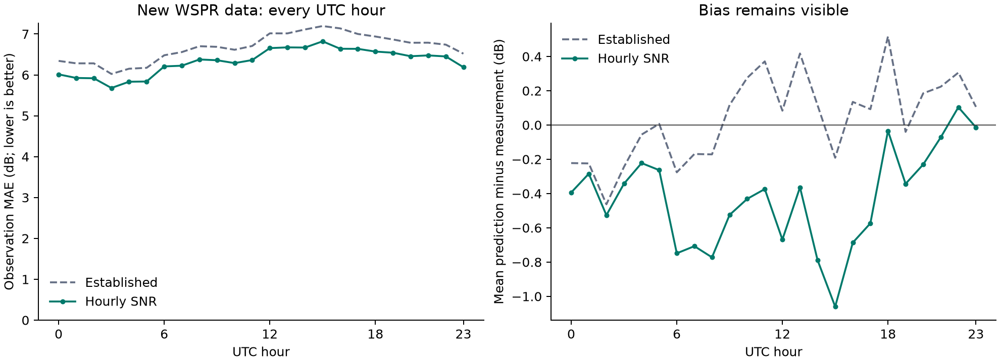
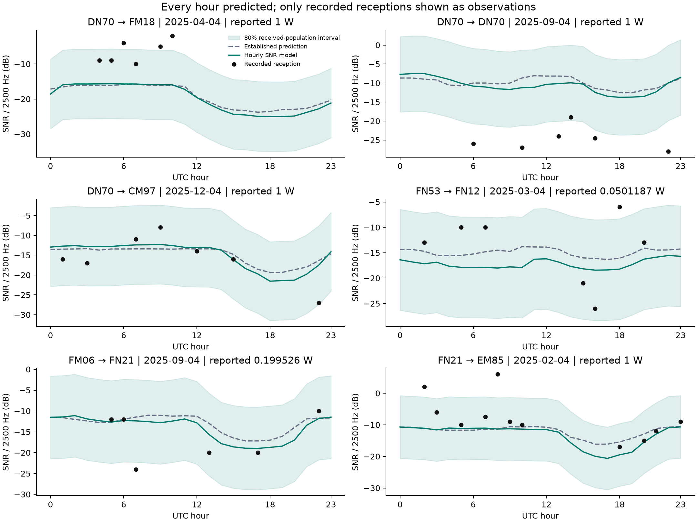

# Hour-by-hour 40m SNR prediction

**The core hourly strength estimates improve.** On **157,382 new WSPR reception aggregates** from **12 untouched dates**, equally weighted hour/date-cell mean absolute error falls from **6.67 to 6.32 dB**, a **5.1% reduction**. The 95% paired date-bootstrap interval for the change is **[-0.369, -0.316] dB**. Lower error is better.

This experiment selects models by the accuracy of the SNR predicted for each observed hour. It does not select or evaluate a strongest hour and uses no ranking score. The product predicts all 24 requested hours, including hours with no reports; unreported measurements remain unknown. The point estimate is trained with absolute-error loss and represents a typical/conditional-median SNR among received signals.

| Fresh observation profile | Dates | Observations | Reference hourly error | Selected candidate error | Recommended outcome |
|---|---:|---:|---:|---:|---|
| WSPR | 12 | 157,382 | 6.67 dB | 6.32 dB | Use new model |
| FT8 | 3 | 39,735 | 6.85 dB | 6.81 dB | Use new model |
| FT4 | 3 | 4,470 | 7.21 dB | 7.53 dB | Retain reference |
| CW | 2 | 24,573 | 7.04 dB | 6.97 dB | Use new model |

FT8/CW gains are small and have limited new-date support; their date-cluster bootstrap intervals describe these samples, not universal guarantees. FT4 failed the new-date comparison and its established model is retained.

## What changed

Validation diagnostics separated errors by UTC hour, transmitter/receiver local solar hour, distance, season, geomagnetic activity, SFI, reported power and station support. Local daytime, longer paths and higher WSPR powers showed different error patterns. [The complete validation diagnosis](results/ml40/hourly/validation_diagnostics.csv) was generated before candidate fitting. These associations do not establish physical causes.

Five source-specific native-SNR regressors were tested per mode: base versus richer features, day-balanced versus hour-balanced versus observation weighting, and stronger smoothing. Reported WSPR power stays a learned predictor; unknown FT8/FT4/CW power stays unknown. This avoids forcing a one-dB-per-dB power normalization on a detection-selected population. Native models include explicit cyclic local solar time and, where selected, path illumination and preceding solar-history features.

Two small residual-correction challengers were also trained for WSPR on 24 new 2023/2024 dates absent from the reference model's fitting data. Their corrections were clipped and regularized. Validation favored the native regressors instead. All candidate settings and selection rules were fixed before fresh test scoring.

| Mode | Validation-selected model | Validation reference hourly MAE | Validation candidate hourly MAE |
|---|---|---:|---:|
| WSPR | `WSPR_native_rich_observation` | 6.80 dB | 6.32 dB |
| FT8 | `FT8_native_rich_observation` | 7.00 dB | 6.96 dB |
| FT4 | `FT4_native_rich_observation` | 6.44 dB | 6.16 dB |
| CW | `CW_native_base_day` | 7.24 dB | 6.71 dB |

The primary error averages absolute SNR errors within each observed UTC hour/date cell, then gives those cells equal weight. It avoids allowing a few densely reported hours to determine the whole result. Overall observation MAE, RMSE and bias are also checked. Missing cells are not filled with artificial signal levels or closed-path labels.

## WSPR absolute accuracy and uncertainty

| Metric | Reference | Hourly SNR model |
|---|---:|---:|
| Hour/date-balanced MAE | 6.67 dB | 6.32 dB |
| Observation MAE | 6.64 dB | 6.30 dB |
| RMSE | 8.35 dB | 7.99 dB |
| Mean bias (prediction minus measurement) | +0.02 dB | -0.44 dB |
| Nominal 80% interval coverage | 80.7% | 79.5% |
| Mean total interval width | 21.48 dB | 19.87 dB |
| Mean 80% interval score (lower is better) | 29.06 | 28.00 |

The error reduction does not eliminate bias: the new model has a modest negative mean bias. Intervals are separately calibrated from held-out calibration dates using finite-sample absolute-residual quantiles. Coverage is measured on new receptions; operational, out-of-domain or unreported-signal coverage is not guaranteed.

Pooled by UTC hour across the new dates, WSPR observation MAE improves in **24 of 24 hours**. [All hour-by-hour errors and biases](results/ml40/hourly/hour_by_hour_errors.csv) are saved.



## Examples: predict every hour, compare where observations exist

Six fixed-station-pair/date examples were selected by identifier hash and available recorded hours, without looking at signal strengths or model errors. Each uses a constant reported WSPR transmit power and the actual completed historical solar indices. Every hour has a prediction and uncertainty band. Black points mark measured receptions; empty measured hours remain unknown. These examples are illustrations, not the full evaluation population. Individual station pairs can remain consistently above or below the population estimate because antennas and noise are unknown; overall interval coverage does not guarantee the same coverage for every individual path. Same-square endpoints also do not establish zero true distance: geometry uses the four-character square centres.



[Inspect all 144 predicted hours and their available measurements](results/ml40/hourly/24hour_examples.csv).

## Station and geographic transfer

The selected WSPR learner was refitted after excluding designated callsigns or geographic fields in both endpoint roles. It was compared with the corresponding previously verified reference exclusion model on new-date receptions.

| Exclusion | Observations | Reference hourly MAE | Candidate hourly MAE | 95% interval for change |
|---|---:|---:|---:|---|
| station_holdout | 60,137 | 6.78 dB | 6.66 dB | [-0.141, -0.094] dB |
| geographic_holdout | 3,144 | 5.67 dB | 5.61 dB | [-0.175, +0.041] dB |

The excluded-station gain is supported by this test. Geographic transfer is less certain: its interval includes zero, observation MAE is essentially unchanged, and negative bias increases. This is not evidence of a universal improvement for every location.

## Fresh-data provenance and limits

WSPR final testing uses the fourth day of every month in 2025, sampled by a deterministic event-ID hash. PSK/RBN archives were planned for April 4, July 4 and October 4. October 4 was absent from the public archive catalog; October 6 was selected by an availability-only rule before scoring, with no change to models. [The amendment](results/ml40/hourly/availability_amendment.json) records the decision. October 6 contains no RBN layer, so CW has two fresh dates; FT8 and FT4 have three. An absent archive layer is not evidence of a closed propagation path.

RBN modes are matched to original daily CSV events, and verified native CW SNR is converted from 500 Hz to 2500 Hz noise bandwidth by subtracting 10 log10(5). A few copied HARC values differ from the original RBN values; the prepared CW targets use the verified original values. Source audits retain that discrepancy. PSK retains reported FT8/FT4 SNR conventions. Archive geolocation provenance can mix reported and lookup locations.

The core limitation remains unknown antenna characteristics, local noise and, outside WSPR, transmitter power. The user chose archive-only work. No claim is made that these are independently calibrated predictions for actual 100 W dipoles, or unconditional reception/contact probabilities. PHONE and other mode margins remain theoretical.

## Query 24 hourly estimates

```sh
.venv/bin/python -m ml40.hourly_query \
  artifacts/gocap-40m-hourly.joblib \
  JN76 FN31 2026-11-17T00:00Z \
  --sfi 150 --kp 3 --ap 10 --power-watts 100 --hours 24
```

The default output is a table of UTC hour, predicted SNR, nominal 80% interval and theoretical mode margins. Use `--format json` for all fields. There are no ranking or strongest-hour fields. `--mode` selects WSPR, FT8, FT4 or CW observation profiles. Power is used only for WSPR; other profiles explicitly retain unknown transmitter power.

Without a history file, the query assumes steady preceding-72-hour Kp and preceding-27-day SFI, with `--ap` providing independent previous-day Ap. A single-hour query can use `--history-file` with 24 completed three-hour Kp values and a checked ending boundary, plus optional preceding 27-day SFI values. Historical tests use actual completed indices; this does not test the accuracy of solar forecasts. Marginal out-of-range inputs are flagged.

## Reproduce and inspect

```sh
.venv/bin/python -m ml40.hourly_diagnose
.venv/bin/python -m ml40.hourly_collect
.venv-hdf/bin/python -m ml40.hourly_harc
.venv/bin/python -m ml40.hourly_prepare_harc
.venv/bin/python -m ml40.hourly_train
.venv/bin/python -m ml40.hourly_stress
.venv/bin/python -m ml40.hourly_evaluate
.venv/bin/python -m ml40.hourly_verify
.venv/bin/python -m ml40.hourly_examples
.venv/bin/python -m ml40.hourly_scenario_check
.venv/bin/python -m ml40.hourly_report
```

- [Frozen plan](results/ml40/hourly/plan.json)
- [Candidate validation and final results](results/ml40/hourly/run.json)
- [Independent verification](results/ml40/hourly/verification.json)
- [New model metadata](artifacts/gocap-40m-hourly.json)
- [Earlier experiment and source links](ML40_RESULTS.md)

## Scalar-query history diagnostic

When current hourly Kp and previous-day SFI/Ap are supplied but preceding histories are assumed steady, WSPR hourly error is **6.32 dB**, versus **6.67 dB** for the established model under the same assumption. This post-freeze diagnostic does not change the selected models or measure solar-forecast accuracy. [Inspect the complete history-assumption comparison](results/ml40/hourly/scenario_history_diagnostic.json).
