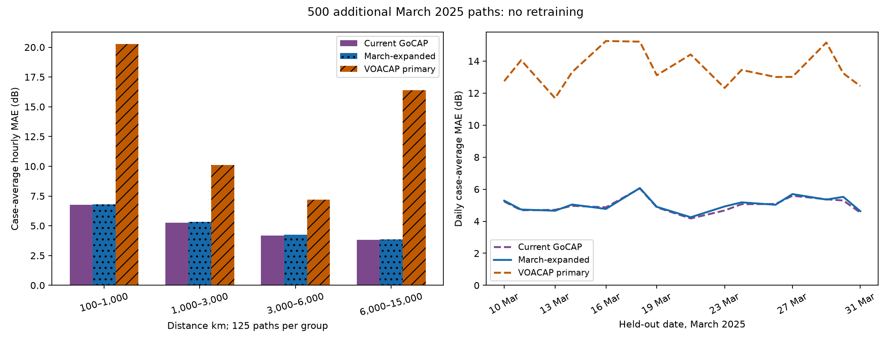
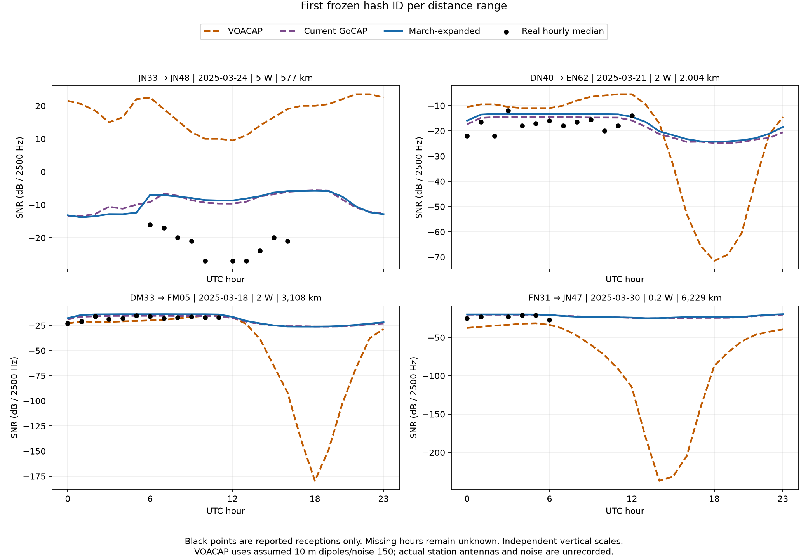

# Additional unseen March 2025: GoCAP versus VOACAP

**All GoCAP variants have lower received-signal error than VOACAP under the declared settings. The March-expanded model is slightly worse than current GoCAP on this test.** On 500 new path-days, case-average hourly MAE is **5.007 dB current**, **5.063 dB March-expanded**, and **13.49 dB VOACAP primary**. No model was retrained or adjusted. The default remains unchanged.

Truth: **4,867 observed hourly medians from 14,415 positive WSPR reports**, across 15 previously unscored March 2025 dates. These dates are absent from fitting and from the six March 2025 dates evaluated during the expansion experiment. This tests March performance without scoring March 2010–2024 fitting observations.

| Same paired observed hours | Case-average hourly MAE | Pooled hourly MAE | RMSE | Signed bias (prediction−observation) |
|---|---:|---:|---:|---:|
| Current default GoCAP | 5.007 dB | 5.136 dB | 6.493 dB | 0.109 dB |
| Shared parent | 5.013 dB | 5.156 dB | 6.510 dB | 0.188 dB |
| March-expanded GoCAP | 5.063 dB | 5.183 dB | 6.546 dB | 0.426 dB |
| VOACAP primary | 13.491 dB | 13.738 dB | 16.825 dB | 3.384 dB |

The March model wins **425/500** cases against primary VOACAP and **242/500** against current GoCAP. Its case-average difference versus current is **+0.056 dB**, with 95% date-cluster bootstrap **[0.011, 0.104] dB**. The interval lies above zero: this is a small regression on the selected cohort, not a reason to promote the larger-data candidate. It does not establish a universal ranking across populations.

Against the shared parent the March change is **+0.050 dB**, interval **[-0.000, 0.100] dB**. Against VOACAP it is **-8.428 dB**, interval **[-8.995, -7.902] dB**. Bootstrap uses 10,000 resamples of 15 dates. Routes/stations recur and selection depends on successful reporting, limiting wider inference.



| Distance km | Cases | Current MAE dB | March-expanded MAE dB | VOACAP MAE dB |
|---|---:|---:|---:|---:|
| 100–1,000 |125 | 6.750 | 6.791 | 20.255 |
| 1,000–3,000 |125 | 5.271 | 5.342 | 10.109 |
| 3,000–6,000 |125 | 4.171 | 4.262 | 7.196 |
| 6,000–15,000 |125 | 3.833 | 3.854 | 16.402 |

## What was held out

Source dates are March 2025 days **10, 11, 13, 14, 16, 18, 19, 21, 23, 24, 26, 27, 29, 30, 31**. None was used in the original, shared or March-expanded point fitting. The earlier March 2025 experiment used 09/12/17/20/25/28; older benchmark days were also excluded. All three model hashes were frozen before source collection. The selected 500 case IDs were frozen before prediction, using only identifiers and availability/measurement-validity criteria.

Each case fixes transmitter/receiver callsigns, directed four-character squares, day, reported power and observation context. Require at least 6 measured hours, 20–50dBm reported power and 100–15,000km distance. Identifier-hash/date round-robin selection yields 125 cases per distance stratum and 500 distinct directed square pairs. Routes may overlap earlier suites; the dates are new. No SNR magnitude or model error chooses cases.

The primary score averages each case's hourly absolute SNR error, then cases equally. This is not directly interchangeable with the earlier 6-date March score of 6.467 dB, which used all sampled rows and equal UTC-hour/date cells. A lower numerical score here does not mean that a model changed or improved: the models are unchanged and the evaluation population/weighting differ.

## Hourly curves and unknown reports



Examples are the first frozen hash ID per distance group, not favorable cases chosen after scoring. Models predict all 12,000 requested hours; only **4,867** have observed truth. The remaining **7,133 hours stay unknown**, never zero or closed-path labels. All case/hour predictions and actual measurements where available are in the accompanying CSV. Independent vertical scales preserve the full native range.

## VOACAP settings and sensitivity

Primary: `dipole10m_n150_s1.0`, matching earlier benchmarks—native Method 30/CCIR, short great-circle path at 7.04 MHz between square centres, matched reported transmitter power, ideal half-wave horizontal dipoles 10 m high broadside to the path at both ends, ground dielectric 4/conductivity 0.001 S/m, noise 150, minimum takeoff 3° and final SILSO 13-month smoothed Version 2 SSN. Real station antennas, height/losses and receiver noise remain unknown.

Native SNR50 is a monthly median across days in dB-Hz. Subtract 33.9794 dB to express 2500 Hz SNR, using the requested-frequency column rather than MUF/REL. Average native H/H+1 dB SNR for the received hourly-bin centre. Left/right native-hour sensitivities give **13.611/13.461 dB** case-average error. All 4,867 observed hours have numeric predictions under all twelve settings.

| Predeclared VOACAP setting | Case-average MAE |
|---|---:|
| dipole10m_n145_s0.6 | 14.076 dB |
| dipole10m_n145_s1.0 | 13.412 dB |
| dipole10m_n150_s0.6 | 14.129 dB |
| dipole10m_n150_s1.0 | 13.491 dB |
| dipole10m_n155_s0.6 | 14.464 dB |
| dipole10m_n155_s1.0 | 13.844 dB |
| isotropic_n145_s0.6 | 10.507 dB |
| isotropic_n145_s1.0 | 10.243 dB |
| isotropic_n150_s0.6 | 10.531 dB |
| isotropic_n150_s1.0 | 10.117 dB |
| isotropic_n155_s0.6 | 10.918 dB |
| isotropic_n155_s1.0 | 10.401 dB |

The scenario range is **10.12–14.46 dB**. No favorable setting replaces the primary after scoring. SSN 0.6 explores a legacy convention, not an exact historical-scale reconstruction. Final retrospective solar indices are used; this is not an archived forecast-vintage test.

This is a detected-signal accuracy comparison. VOACAP's monthly climatological target differs from a specific day's received-population median, and unknown hardware/noise prevents a controlled physical calibration. PHONE remains theoretical; no contact probabilities or accuracy in unreported hours are established. These limits apply even though the GoCAP errors are lower under every declared setting.

## Evidence and reproduce

- [Frozen plan](results/ml40/march2025voa/plan.json), [frozen cases](results/ml40/march2025voa/case_freeze.json), [summary](results/ml40/march2025voa/summary.json).
- [500 case results](results/ml40/march2025voa/case_results.csv), [all 12,000 hourly comparisons](results/ml40/march2025voa/hourly_comparison.csv), [per-date](results/ml40/march2025voa/per_date.csv), [per-distance](results/ml40/march2025voa/per_distance.csv).
- [Independent verification](results/ml40/march2025voa/verification.json), [6,000 native run checksums](results/ml40/march2025voa/run_manifest.csv), [sensitivity](results/ml40/march2025voa/sensitivity.csv).

Exact time/band-bounded source queries, retrieval timestamps, raw responses, source features and native input/output decks remain under ignored `data/ml40/march2025voa/`. Sampling uses coherent pair/day hash 128 plus hash 16 for source distances ≥2,700 km, with a 250,001-row cap that fails rather than truncate. Modern code 1 WSPR observations are used. The unchanged source processor and fitting-date separation are independently checked.

```sh
.venv/bin/python -m ml40.march_test_collect
.venv/bin/python -m ml40.march_test_prepare
.venv/bin/python -m ml40.march_test_run
.venv/bin/python -m ml40.march_test_verify
.venv/bin/python -m ml40.march_test_report
.venv/bin/python -m unittest discover -v
```

Restore exact cached inputs and the native engine matching frozen hashes for reproduction. No model is fitted by these commands. Further tuning must reserve other untouched dates rather than optimize against this now-published test. Data/source access conditions and credits are in [README](README.md); the [March training report](MARCH_MODEL_RESULTS.md) and [15-year April comparison](VOACAP_15YEAR_COMPARISON.md) describe the related experiments. Primary references: [WSPR Live](https://wspr.live/), [VOACAP SNR interpretation](https://www.voacap.com/2023/understanding/muf.html), [SSN guidance](https://www.voacap.com/2023/understanding/choosingssn.html). SILSO credit: WDC-SILSO, Royal Observatory of Belgium, DOI 10.24414/qnza-ac80; CC BY-NC research use.

**Decision: retain current default GoCAP.** Independent checks rebuild all 4,867 hourly medians from 14,415 raw reports, parse 6,000 native runs, reproduce date/case/hour errors and bootstrap intervals, and confirm frozen model/source hashes. The March-expanded artifact stays experimental. No test-driven refitting occurred.
