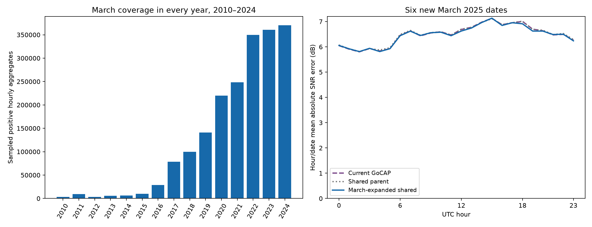

# March expansion: every year from 2010 through 2024

**A separate model has been trained with March data from all 15 years.** The expansion adds **1,821,048 unique hourly WSPR records** to the existing multi-mode training set, for **2,950,381 training records across 699 days**. The new March dates show lower hourly error than the shared parent. The existing deployed model is retained; this new artifact is experimental.

## Exactly what was added

All **465 calendar-day windows** were requested: March 1–31 of every year, 2010–2024 inclusive. **465 days** contain usable positive reception aggregates. Collection uses the same deterministic **1-in-128 event-hash sample** as the earlier dataset. This is full calendar-month coverage, not a download of every raw reception in those months.

March2020 `code=0` archive reports initially failed the inherited cutoff. Before fitting, an [explicit amendment](results/ml40/march40/legacy_mode_amendment.json) retained them as `legacy_code0`, with decoder/mode uncertainty preserved. This does not certify a modern decoding threshold. [WSPR Live documents the historical/current code mappings](https://wspr.live/), and the [WSJT developers announced the first public FST4/FST4W release candidate in September2020](https://sourceforge.net/p/wsjt/mailman/message/37117193/), after the added March window. No prior artifacts or datasets were modified.

The augmentation is WSPR data. Existing FT8, FT4 and CW training records are retained; no additional full-month PSK/RBN archive or PHONE measurements are claimed. The final training counts are WSPR **2,832,667**, FT8 **51,056**, FT4 **9,138**, CW **57,520**.

Original observations are preserved exactly once. **90,670 overlapping March aggregates** were removed from the addition after checking their SNR/report counts against the original samples. Existing validation and calibration dates stay outside fitting, including **2024-03-08 and 2024-03-22**. Consequently those two days are collected but not used to fit the point model. **No 2025 reception data enters training.** Empty or unreported slots remain unknown, never closed-path labels.

| Year | Requested March days | Available sampled days | Raw sampled reports | Positive hourly aggregates |
|---|---:|---:|---:|---:|
| 2010 | 31 | 31 | 3,590 | 3,527 |
| 2011 | 31 | 31 | 9,641 | 9,517 |
| 2012 | 31 | 31 | 3,117 | 3,082 |
| 2013 | 31 | 31 | 5,836 | 5,758 |
| 2014 | 31 | 31 | 6,337 | 6,253 |
| 2015 | 31 | 31 | 10,056 | 9,883 |
| 2016 | 31 | 31 | 29,021 | 28,612 |
| 2017 | 31 | 31 | 80,014 | 78,574 |
| 2018 | 31 | 31 | 101,282 | 99,810 |
| 2019 | 31 | 31 | 143,689 | 141,220 |
| 2020 | 31 | 31 | 223,782 | 219,909 |
| 2021 | 31 | 31 | 252,548 | 248,343 |
| 2022 | 31 | 31 | 355,464 | 349,782 |
| 2023 | 31 | 31 | 367,114 | 360,603 |
| 2024 | 31 | 31 | 380,151 | 370,574 |

The per-year aggregate counts include reserved March validation/calibration windows and duplicates before the fitting-only merge. [Every requested date and its role](results/ml40/march40/march_coverage.csv) and [the complete final training-date manifest](results/ml40/march40/training_dates.csv) distinguish those populations.

## Model and memory handling

The fixed shared-parent specification is unchanged: one pooled source/mode-aware histogram gradient-boosted regressor, absolute-error loss, 240 iterations, 31 leaves, minimum leaf size 100, L2=10 and learning rate 0.05. It retains all 45 explicit features at 0%, 25%, 50%, 75% and 100% of the path, plus the existing nine-point summaries and completed solar history. There was **no new hyperparameter search or test-driven retuning**; the experiment tests a data expansion. On the unchanged validation partition, equal-mode hour/date MAE is **6.756 dB expanded**, **6.695 dB parent**, and **6.609 dB current**. The expanded model is not an overall validation winner.

On this 16 GB machine, features are encoded in batches into disk-backed arrays. Training medians are computed over the complete training matrix one feature at a time, not estimated from a small batch. The exported encoder retains only its fitted statistics and categories; inference needs no matrix files or reception archive. Peak process RSS recorded during training was approximately **4.74 GiB**. The compact training DataFrame occupies approximately **715 MiB**, excluding matrices and learner workspace.

New artifact: [`gocap-40m-shared-march.joblib`](artifacts/gocap-40m-shared-march.joblib), **1,009,487 bytes**; SHA256 `069e77ed680720cb546e4c5ff8a996569375d02bb691b064577dcdcefb0d734c`. More training data does not require a larger number of trees when the architecture is fixed.

## Fresh March evaluation

Six dates were reserved before collection/fitting: **2025-03-09, 12, 17, 20, 25 and 28**. They were not in the original or shared-model comparison suites. The artifact was frozen before scoring their **83,263 observed hourly records**. The primary metric gives equal weight to each observed UTC hour/date cell; lower error is better. These are received-signal measurements, not a test of unknown-hour band-open probabilities.

| Model | Hour/date MAE (primary) | Pooled MAE | RMSE | Signed bias |
|---|---:|---:|---:|---:|
| Current GoCAP | 6.482 dB | 6.464 dB | 8.300 dB | -1.073 dB |
| Shared + five points parent | 6.494 dB | 6.476 dB | 8.302 dB | -1.021 dB |
| March-expanded shared | 6.467 dB | 6.447 dB | 8.271 dB | -0.644 dB |

March-expanded minus shared parent: **-0.027 dB**, 95% date-cluster bootstrap **[-0.041, -0.012] dB**. March-expanded minus current GoCAP: **-0.015 dB**, interval **[-0.039, 0.007] dB**. Only six date clusters are available; these intervals do not establish performance for all years, seasons or stations.

Nominal 80% received-population intervals cover **79.30%** of the new observations, with mean width **20.09 dB**. Calibration uses the original pre-2025 calibration partition separately from fitting.



## Known-benchmark checks

The previous 500-path benchmark was replayed for a broader seasonal check. It is **already published and no longer a blind test**; the observations, original predictions and VOACAP settings are unchanged. Equally weighted path MAE is **5.303 dB March-expanded**, **5.267 dB shared parent**, **5.270 dB current GoCAP**, and **13.938 dB VOACAP**. This reuses the existing VOACAP predictions; it is not a new native-engine experiment.

The existing 2025 FT8/FT4/CW audit is also a known benchmark. Below are hour/date-balanced MAEs, in dB:

| Mode | Observations | Current GoCAP | Shared parent | March-expanded |
|---|---:|---:|---:|---:|
| FT8 | 39,735 | 6.811 | 6.838 | 6.838 |
| FT4 | 4,470 | 7.211 | 7.169 | 7.072 |
| CW | 24,573 | 6.966 | 6.889 | 6.922 |

These other-mode checks have only two or three dates. Added WSPR volume can change the balance of a pooled model, so a March-specific gain alone is insufficient to establish overall model improvement. The default model is not automatically replaced.

## Run the new model

Use the pinned environment described in [README](README.md):

```sh
.venv/bin/python -m ml40.hourly_query \
  artifacts/gocap-40m-shared-march.joblib \
  JN76 FN31 2026-11-17T00:00Z \
  --sfi 150 --kp 3 --ap 10 --power-watts 5 --hours 24
```

Append `--format json` for structured output. In the default WSPR reference context, one SNR supplies all theoretical mode margins. The source/mode context, unknown antennas/noise and unknown non-WSPR powers still prevent a physically identified universal channel-gain model. PHONE remains threshold-only and physically uncalibrated. See the [shared-model report](SHARED_MODEL_RESULTS.md) for those limits.

## Evidence and reproduction

- [Frozen plan](results/ml40/march40/plan.json), [collection ledger](results/ml40/march40/collection.json), [coverage by year](results/ml40/march40/coverage_by_year.csv).
- [Preparation audit](results/ml40/march40/preparation.json), [training record](results/ml40/march40/training_run.json), [evaluation summary](results/ml40/march40/summary.json).
- [Fresh hourly errors](results/ml40/march40/fresh_march_hourly_errors.csv), [known 500-path errors](results/ml40/march40/known500_case_errors.csv), [other-mode audit](results/ml40/march40/known_mode_audit.csv), [independent verification](results/ml40/march40/verification.json).

Raw exact queries, source checksums, processed samples, fitting features and disk-backed matrices stay under ignored `data/ml40/march40/`. The source is WSPRNet contributors via WSPR Live, using bounded sequential cached requests. Existing GFZ/DRAO solar data, IAGA/NOAA magnetic coefficients and original PSK/RBN records retain the attribution and access conditions in [README](README.md). Historical decoder-context limitations remain explicit; pre-2020 code0 and pre-2023 code1 are not claimed to share one known decoding threshold.

```sh
.venv/bin/python -m ml40.march_collect
.venv/bin/python -m ml40.march_repair_legacy
.venv/bin/python -m ml40.march_prepare
.venv/bin/python -m ml40.march_train
.venv/bin/python -m ml40.march_evaluate
.venv/bin/python -m ml40.march_verify
.venv/bin/python -m ml40.march_report
.venv/bin/python -m unittest discover -v
```

These research stages require the exact original fitting/validation/calibration caches and previous benchmark features, which are excluded from Git. Frozen hashes reject changed inputs. Preserve old artifacts and use a new versioned experiment for further data changes. Independent verification reconstructs the daily medians directly from raw reports, checks duplicate retention and temporal separation, validates global encoder medians and sampled encoded rows, and independently rebuilds reported errors and bootstrap intervals.
