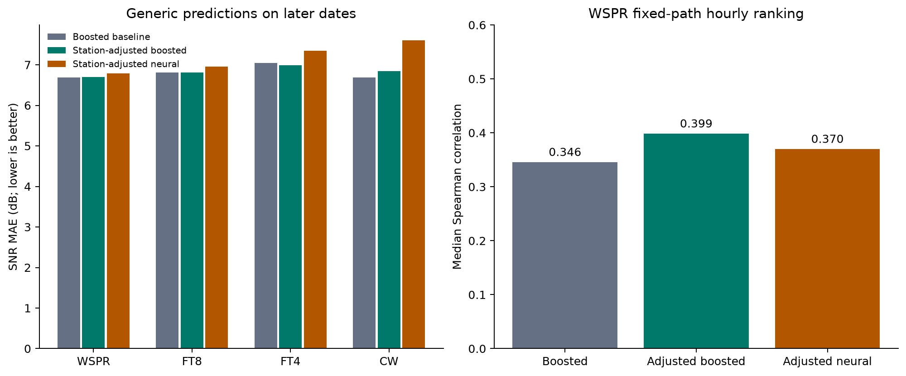

# 40m learned propagation model — second experiment

**Scope:** positive-reception SNR and hourly ranking. Missing reports remain unknown. The population reference is not an independently calibrated 100 W/dipole station.

The station-adjusted boosted model improved the primary hourly ranking check: median correlation rose from **0.346 to 0.399** over **2,905 fixed-path/day cases**. Mean loss from the best observed hour fell from **4.96 to 4.82 dB**. Generic WSPR SNR error was essentially unchanged (**6.69 versus 6.70 dB MAE**). The neural challenger did not outperform the boosted models overall. This supports a modest ranking improvement, not calibrated contact probabilities.

The prepared sample contains **2,044,084 hourly aggregates** on **318 distinct days**. The primary WSPR collection covers the 324 planned dates; empty source responses are not classified as closed paths. Historical PSK/RBN samples cover the selected seasonal HARC dates. Exact source/mode/split support appears below.

## Model design

Three compact learners share numeric geometry/time/solar features and explicit source/mode/decoder context. They use no reception-history query at inference. Transmitter/receiver offsets are learned from date-cross-fitted training residuals, regularized and centered; unseen keys receive zero correction. The neural challenger has hidden layers of 64 and 32 neurons. Candidate and epoch decisions use validation only.

Numeric preprocessing, nuisance offsets and model weights are fitted without final test rows. Intervals use a separate calibration split. Strict experiments exclude designated callsigns or geographic fields from training, validation and calibration in both endpoint roles.

## Frozen choice and later-period SNR error

The standard model selected before final scoring was **Station-adjusted boosted**, using validation station-pair hour ranking; balanced MAE tie-break. The following errors are the generic population-core predictions available from squares and conditions alone; they exclude optional known-station corrections. Lower MAE is better.

| Mode | Test observations | Test days | Boosted baseline MAE | Adjusted boosted MAE | Adjusted neural MAE |
|---|---:|---:|---:|---:|---:|
| WSPR | 487,838 | 36 | 6.69 dB | 6.70 dB | 6.79 dB |
| FT8 | 37,100 | 3 | 6.81 dB | 6.81 dB | 6.96 dB |
| FT4 | 1,744 | 3 | 7.04 dB | 6.99 dB | 7.34 dB |
| CW | 22,007 | 2 | 6.69 dB | 6.84 dB | 7.60 dB |

These are conditional predictions of reported receptions. Source populations, unknown transmitter power outside WSPR, antennas and local noise remain mixed in the observations. A lower error is not evidence of calibrated path-open probabilities.

## Primary hourly ranking check

The independent WSPR ranking cohort retains reported receptions for outcome-blind station-pair/day keys. A case must have at least six observed hours and at least three distinct measured strengths. Station pairs must remain in the same four-character squares. Known WSPR power is adjusted to a common reference before ranking. Unreported hours never become negative examples.

| Model | Fixed-path/day cases | Test days | Median Spearman rank correlation | Mean loss from best observed hour |
|---|---:|---:|---:|---:|
| Boosted baseline | 2,905 | 36 | 0.346 | 4.96 dB |
| Station-adjusted boosted | 2,905 | 36 | 0.399 | 4.82 dB |
| Station-adjusted neural | 2,905 | 36 | 0.370 | 4.86 dB |

## WSPR generalization stress checks

Generic SNR predictions on reserved dates; compare models within each row because the held-out populations differ. Designated stations and fields are excluded from fitting in both endpoint roles.

| Test population | Observations | Baseline MAE | Adjusted boosted MAE |
|---|---:|---:|---:|
| Both stations unseen | 55,574 | 6.95 dB | 6.87 dB |
| Excluded geographic fields | 10,287 | 5.88 dB | 5.86 dB |

The saved ranking table also includes square-pair aggregation, the scattered main sample, strict unseen-station and geographic-field cases, and source-specific HARC ranking checks. Per-hour actual and predicted values are retained for the primary coherent cohort.

## Uncertainty calibration

An 80% nominal interval is formed from per-source/mode absolute prediction residuals on the separate calibration dates. Temporal distribution shifts and station changes mean that 80% future coverage is not guaranteed; the table reports measured final-test coverage.

| Mode | Model | Observed coverage | Mean width |
|---|---|---:|---:|
| WSPR | Boosted baseline | 80.4% | 21.3 dB |
| WSPR | Station-adjusted boosted | 80.4% | 21.5 dB |
| WSPR | Station-adjusted neural | 80.2% | 21.7 dB |
| FT8 | Boosted baseline | 81.3% | 22.5 dB |
| FT8 | Station-adjusted boosted | 81.2% | 22.5 dB |
| FT8 | Station-adjusted neural | 80.6% | 22.5 dB |
| FT4 | Boosted baseline | 79.6% | 22.1 dB |
| FT4 | Station-adjusted boosted | 80.2% | 22.1 dB |
| FT4 | Station-adjusted neural | 77.2% | 22.4 dB |
| CW | Boosted baseline | 81.1% | 22.2 dB |
| CW | Station-adjusted boosted | 81.3% | 23.0 dB |
| CW | Station-adjusted neural | 81.3% | 25.0 dB |

Intervals describe the observed reception population. They do not recover the unseen sub-threshold distribution. Theoretical WSPR/FT8/FT4/CW/SSB margins can be calculated from a predicted SNR, but inherit these measurement and calibration limits.

## Source and split support

| Source | Mode | Split | Hourly observations |
|---|---|---|---:|
| HARC_PSK | FT4 | calibration | 524 |
| HARC_PSK | FT4 | test | 1,744 |
| HARC_PSK | FT4 | train | 9,138 |
| HARC_PSK | FT4 | validation | 3,543 |
| HARC_PSK | FT8 | calibration | 20,734 |
| HARC_PSK | FT8 | test | 37,100 |
| HARC_PSK | FT8 | train | 51,056 |
| HARC_PSK | FT8 | validation | 30,467 |
| HARC_RBN | CW | calibration | 31,556 |
| HARC_RBN | CW | test | 22,007 |
| HARC_RBN | CW | train | 57,520 |
| HARC_RBN | CW | validation | 18,334 |
| WSPRNET | WSPR | calibration | 128,453 |
| WSPRNET | WSPR | test | 487,838 |
| WSPRNET | WSPR | train | 1,011,619 |
| WSPRNET | WSPR | validation | 132,451 |

WSPR has broad calendar coverage; PSK/RBN have a smaller seasonal panel. The source-specific test-day counts matter when assessing generalization. Legacy WSPR code 0 and pre-2023 mode ambiguities retain explicit decoder context. HARC coordinates can mix reported and lookup locations without a per-record provenance flag. Explicit UTC fields are cross-checked against original RBN events; source epoch discrepancies and unmatched modes are retained in archive audits.

## Compact inference and reproducibility

Load the selected artifact with `ml40.inference`. It computes features from squares, UTC time and the supplied SFI/Kp/Ap scenario, and predicts without loading the reception dataset. Its solar-history default holds Kp steady over the previous completed day and uses Ap as independent previous-day context. This is a stated scenario assumption, not a solar forecast. Marginal training-range checks do not establish support for every joint solar scenario.

| Standard artifact | Size |
|---|---:|
| Boosted baseline | 507 KiB |
| Station-adjusted boosted | 801 KiB |
| Station-adjusted neural | 408 KiB |

The portable population-core export is [gocap-40m.joblib](artifacts/gocap-40m.joblib) (about 507 KiB), with [checksum and metadata](artifacts/gocap-40m.json). It omits station lookup tables and preserves the selected core predictions.

- [Frozen sample plan and commands](ML40_PLAN.md)
- [Training run, validation decisions and artifact checksums](results/ml40/training_run.json)
- [Final error and coverage metrics](results/ml40/test_metrics.csv)
- [Hour-ranking summary](results/ml40/hour_ranking_summary.csv)
- [Data audit](results/ml40/data_audit.json)
- [Independent verification](results/ml40/verification.json)
- [Original pilot readout](RESULTS.md)

Reception sources: WSPRNet/WSPR Live, PSK Reporter, RBN, and HamSCI/CEDAR Madrigal. Geomagnetic and F10.7 history: GFZ and DRAO/Natural Resources Canada. Models: scikit-learn histogram gradient boosting and MLPRegressor. Access scope and attribution remain as documented in README.md.
