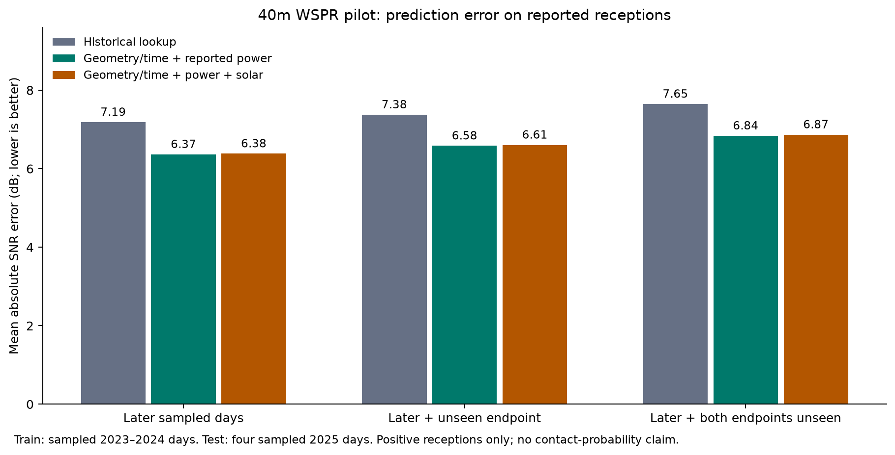

# 40m empirical propagation feasibility experiment

**Assessment: useful initial signal, with substantial calibration limits.**

This pilot tests hourly SNR among successful receptions between four-character Maidenhead squares. Missing reports were never converted into failures. These results do not measure path-open probability, and do not establish absolute performance for a 100 W station with dipoles.

## Samples

- Direct WSPRNet data through WSPR Live: 16 selected days across 2023–2025, sampled by a deterministic 1/64 spot-ID hash. Ordinary WSPR is separated from other modes.
- Historical PSK Reporter and geolocated RBN: January 15, 2024 and January 15, 2025 from HamSCI/CEDAR Madrigal. RBN modes and SNR are checked against the original RBN archives.
- Three original RBN daily files were inspected; they contain no explicit endpoint locators. The November 2026 live PSK probe is audit-only and excluded from training.
- The normalized database contains **437,327** observed station-pair/source/mode/hour/power aggregates, including audit-only live probe aggregates.

| Source | Sample records before filtering | Missing/invalid TX location | Missing/invalid RX location | Duplicate event keys |
|---|---:|---:|---:|---:|
| WSPRNet | 345,826 | 3 (0.0%) | 0 (0.0%) | 0 |
| PSK Reporter / HARC | 69,942 | 4,404 (6.3%) | 53 (0.1%) | 57 |
| RBN / HARC | 67,468 | 5,207 (7.7%) | 2,614 (3.9%) | 703 |

These location rates describe the retained hash samples, not all network traffic. HARC supplies coordinates but does not identify the per-record geolocation method; reported and callsign-lookup locations cannot be distinguished here.

## Later-period SNR prediction

Mean absolute error in dB; lower is better. The learned models use geometry, season, UTC time, approximate sunlight and reported power where available. The solar variant adds prior-period indices. Callsign IDs are excluded from learned features. Both ordinary and power-adjusted historical baselines are retained; the table uses the better historical baseline for each evaluation.

| Mode | Training aggregates | Later test aggregates | Best historical lookup | Geometry/time/power ML | ML plus solar |
|---|---:|---:|---:|---:|---:|
| WSPR | 228,624 | 98,648 | 7.19 | 6.37 | 6.38 |
| FT8 | 30,119 | 22,213 | 6.99 | 6.79 | 6.82 |
| FT4 | 5,775 | 4,916 | 7.19 | 6.95 | 6.99 |
| CW | 27,109 | 18,998 | 7.80 | 7.23 | 7.34 |

WSPR trains on the selected 2023–2024 days and tests four selected 2025 days. FT8, FT4 and CW each train on one January 2024 day and test one January 2025 day. The latter are access/generalization probes, not year-round validations. Solar benefit is unproven: the HARC training data contains only one day, and even the WSPR pilot has just 16 distinct days.

## Unseen endpoint checks

A deterministic callsign subset is excluded from training in both transmit and receive roles. The following tests use later receptions with both endpoint callsigns absent from that training set. Callsigns are station proxies; unrecognized aliases may belong to the same physical station.

| Mode | Training aggregates | Both-unseen test aggregates | Best historical lookup MAE | Geometry/time/power ML MAE |
|---|---:|---:|---:|---:|
| WSPR | 147,789 | 18,178 | 7.65 | 6.84 |
| FT8 | 19,805 | 11,951 | 7.01 | 6.84 |
| FT4 | 3,763 | 3,269 | 7.40 | 7.20 |
| CW | 18,275 | 4,240 | 7.49 | 7.41 |

## Hour selection and reception spread

The hour-ranking check compares only hours that actually have reported receptions. It requires at least six observed hours in a square-pair/day and at least three distinct observed SNR values. WSPR actual and predicted SNR are adjusted to a common reported 1 W before comparing hours; antenna and noise differences remain. See [hour-ranking results](results/hour_ranking_summary.csv). It cannot establish that an unobserved hour was worse.

| Mode | Observed coverage of nominal 80% interval | Mean interval width |
|---|---:|---:|
| WSPR | 77.4% | 19.6 dB |
| FT8 | 73.7% | 19.8 dB |
| FT4 | 66.9% | 17.1 dB |
| CW | 72.0% | 19.9 dB |

These intervals are not calibrated reliability estimates. Their observed coverage and width show that reception strength remains uncertain. The nominal FT8–FT4 sensitivity difference is 3.5 dB, smaller than the SNR error in this pilot; theoretical mode margins should therefore retain that uncertainty.

## Consequential data findings

1. **Historical PSK access is verified.** The two inspected HDF5 files contain explicit PSK source records, including FT8 and FT4. This corrects the earlier suggestion that all historical PSK collection must start now.
2. **Timestamp interpretation matters.** For all 40m records scanned in the 2024-01-15 file, the Unix field is 21,600 seconds ahead of the fields labelled UTC. The 2025-01-15 file agrees. Explicit UTC fields match original RBN events; the pilot uses those fields and preserves the original epoch. This is a checked, file-specific correction, not a blanket six-hour shift.
3. **RBN needs enrichment and mode recovery.** Native archives have no endpoint locators. HARC supplies coordinates, but its RBN mode field is CQ/BEACON. Original RBN records recover CW/RTTY; unmatched modes remain unverified and are excluded. CW SNR is then converted from a 500 Hz to 2,500 Hz noise reference.
4. **Known power does not establish antenna gain.** Direct WSPR retains reported power. Historical PSK/RBN have unknown power here, and their learned models omit that unavailable feature. They cannot yet yield calibrated 100 W/dipole predictions.
5. **Thresholds are not absolute detection cutoffs.** Successful negative-SNR reports are retained. Ordinary regressors predict the detected population; no correction for the full unseen reception distribution has been established. Noise bandwidth conversion does not calibrate receivers or local noise.

## Recommendation

Continue with a broader set of independent days before importing the full history or claiming a VOACAP replacement. Keep the positive-only policy and source-specific models. Prioritize four changes: more seasonal and solar-condition coverage at the same bounded spot budget; verified station/location metadata; a reference noise/antenna calibration subset; and a detection-aware measurement model. Validate any resulting model on new days and callsigns.

A 40m hourly empirical reception-strength tool is feasible enough to continue. Calibrated contact probabilities, closed-path detection, arbitrary out-of-range solar scenarios and absolute PHONE performance have not been demonstrated.

## Reproduction and evidence

- [Reproduction commands and conventions](README.md)
- [Metrics, including balanced error and the solar ablation](results/metrics.csv)
- [Per-day errors](results/per_day_errors.csv) and [distance breakdown](results/distance_errors.csv)
- [Quality audit](results/quality.json) and [feature audit](results/feature_audit.json)
- [2024 archive audit](results/harc-2024-01-15-audit.json) and [2025 archive audit](results/harc-2025-01-15-audit.json)
- [Completed run and artifact hashes](results/run.json)
- [Independent reconciliation of all 12 evaluation groups](results/verification.json)
- [Mode reference profiles and sources](mode_profiles.json)

Reception data are provided by volunteer WSPRNet/RBN/PSK Reporter contributors, WSPR Live, and HamSCI/CEDAR Madrigal. Solar/geomagnetic data are from GFZ and DRAO/Natural Resources Canada. Detailed citations and access scope are in the README.
