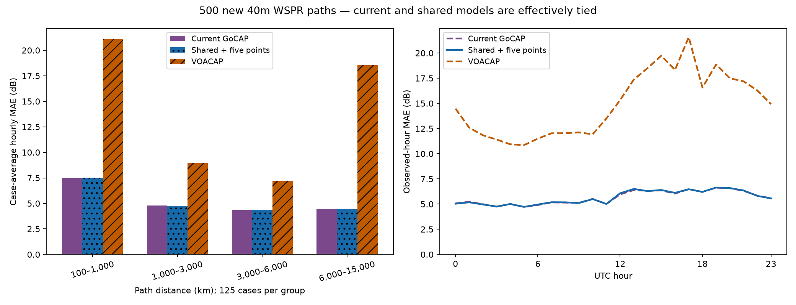
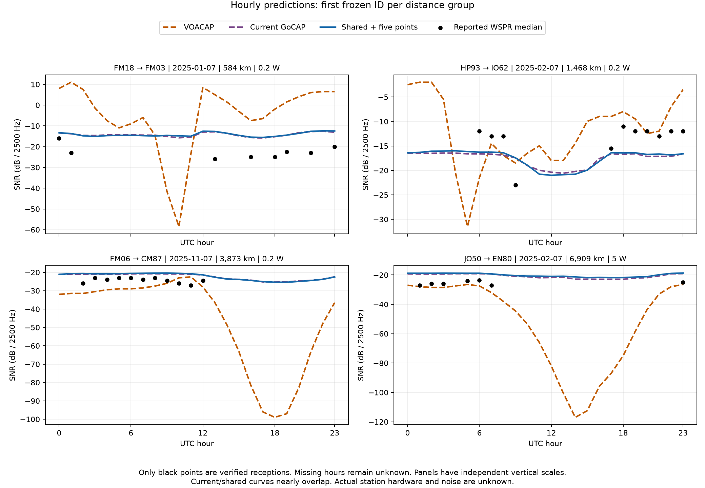

# Shared multi-mode model with five explicit path points

**The new model works, but this experiment does not establish better accuracy than current GoCAP.** On **500 new real WSPR paths**, case-average hourly SNR error is **5.267 dB shared / 5.270 dB current / 13.94 dB VOACAP**. The tiny shared/current difference is within sampling uncertainty. The current deployed model is retained; the new artifact is experimental.

Truth: **4,820 positive hourly medians from 14,894 raw WSPR reports**, spanning the seventh day of each month in 2025. All 500 directed square pairs are distinct and excluded from the previous 100/1,000-path suites. Missing receptions remain unknown. Actual antennas/noise are unrecorded, so VOACAP comparison is under explicit hardware assumptions.

| Same paired observed hours | Current GoCAP | Shared + explicit points | VOACAP primary |
|---|---:|---:|---:|
| Case-average hourly MAE | 5.270 dB | 5.267 dB | 13.938 dB |
| Pooled hourly MAE | 5.456 dB | 5.466 dB | 13.975 dB |
| Pooled hourly RMSE | 6.941 dB | 6.947 dB | 19.936 dB |
| Signed bias | 0.096 dB | 0.122 dB | 3.069 dB |

Shared minus current case-average error: **-0.0024 dB**, 95% paired date-cluster bootstrap **[-0.0334, 0.0363] dB**. It is effectively a tie: shared wins on **255/500** paths, current on **245**. Shared beats VOACAP on **416/500** paths; that result does not establish universally superior propagation physics. Only twelve sampled dates are available; shared stations and detection selection limit generalization.



| Distance group km | Cases | Current MAE dB | Shared MAE dB | VOACAP MAE dB |
|---|---:|---:|---:|---:|
| 100to1000 | 125 | 7.489 | 7.512 | 21.066 |
| 1000to3000 | 125 | 4.782 | 4.761 | 8.953 |
| 3000to6000 | 125 | 4.351 | 4.369 | 7.178 |
| 6000to15000 | 125 | 4.456 | 4.427 | 18.554 |

## What changed

One pooled histogram gradient-boosted regressor was trained on **1,129,333** original pre-2025 hourly records: WSPR **1,011,619**, FT8 **51,056**, FT4 **9,138**, CW **57,520**. It replaces separate per-mode regressors within this candidate package, not the deployed artifact. Raw native SNR targets are standardized to 2500 Hz. Known WSPR power remains an input; unknown other-mode powers remain marked unknown. Encoder numerical imputation does not turn unknown power into a claimed physical measurement. No PHONE reception records were supplied.

The model retains source, mode and decoder context because successful-report populations differ. It is a shared *observation-context SNR model*, not a uniquely identified mode-independent channel-gain model. Pooling alone cannot disentangle unknown transmit power, antennas, noise and reception selection.

At **0%, 25%, 50%, 75% and 100%** along the shortest great-circle path, it adds **45 explicit features**: geographic latitude, cyclic longitude, solar-elevation sine, cyclic local solar time, degree-one geomagnetic latitude, daylight and twilight state. Existing nine-point aggregate geometry and completed solar-history features are retained. These positions describe path conditions, not known ionospheric reflection points. Antipodal interiors are flagged/undefined rather than choosing an arbitrary great circle.

The default new query uses the WSPR reference observation context at supplied power, produces **one reference SNR per hour**, and applies the existing theoretical WSPR/FT8/FT4/CW/PHONE thresholds to that same SNR. This is useful as a scenario interface; physical mode independence, PHONE accuracy and open-path probabilities remain unverified.

## Did the two ideas help?

Four candidates isolate pooling and explicit-point effects: aggregate versus explicit-point features, each with observation weighting or source/mode/hour balancing. All hyperparameters were frozen first: absolute-error loss, 240 iterations, 31 leaves, minimum leaf size 100, L2=10, learning rate 0.05. Selection uses only original 2024 day08 validation; 2024 day22 calibration is separate. Final tests never choose a candidate.

| Shared candidate | WSPR validation MAE | FT8 | FT4 | CW | Equal-mode mean | Regression guards pass |
|---|---:|---:|---:|---:|---:|---|
| pooled_aggregate_observation | 6.357 | 7.019 | 6.359 | 7.081 | 6.704 | True |
| pooled_aggregate_mode_hour | 6.818 | 7.004 | 6.156 | 7.085 | 6.766 | False |
| pooled_points_observation | 6.353 | 6.999 | 6.346 | 7.084 | 6.695 | True |
| pooled_points_mode_hour | 6.827 | 6.989 | 6.192 | 7.101 | 6.777 | False |

Selected: **`pooled_points_observation`**, the lowest validation equal-mode error among eligible point-feature candidates. Guards allow at most 5% WSPR and 10% other-mode regression versus current GoCAP; passing them is not evidence of improvement. The original model's validation equal-mode mean is **6.609 dB**, so the shared candidate is not better overall on that validation criterion either. The mode-balanced candidates failed the WSPR guard.

On the new 500 paths, the matched pooled **aggregate-only** ablation scores **5.270 dB**. Adding explicit points changes case MAE by **-0.0024 dB**, with 95% date-bootstrap **[-0.0291, 0.0230] dB**. There is no demonstrated incremental gain from those explicit features in this experiment. Existing nine-point summaries may already capture much of the useful geometry, but that explanation is a hypothesis, not established causation.

## Other-mode audit

The frozen selected model was additionally checked against the **already published** 2025 FT8/FT4/CW hourly archive. These dates were excluded from fitting but were used in earlier research reports, so this is a known-benchmark audit, not a new blind all-mode test. No unknown power was invented to score VOACAP on these records. Metrics below are hour/date-balanced MAE, not the case-balanced WSPR metric above.

| Mode | Observed hours | Dates | Current GoCAP | Shared + points |
|---|---:|---:|---:|---:|
| FT8 | 39,735 | 3 | 6.811 dB | 6.838 dB |
| FT4 | 4,470 | 3 | 7.211 dB | 7.169 dB |
| CW | 24,573 | 2 | 6.966 dB | 6.889 dB |

CW/FT4 changes are small and have only 2–3 dates; FT8 gets slightly worse. These mixed results do not justify promoting the shared model. PHONE remains theoretical threshold conversion only. The nominal 80% calibrated WSPR interval covers **85.19%** of the new observed hours with mean width **19.96 dB**; it is received-population uncertainty, not confidence that an unreported path is open.

## Hour-by-hour examples



First hash-sorted case per distance stratum, chosen without looking at performance. Current/shared curves almost overlap. Both predict all **12,000 case-hours**; only **4,820** have measured truth, leaving **7,180 unknown**. Very weak native VOACAP values in unreported hours are not scored as successful or failed predictions. Panels use independent vertical scales.

## VOACAP assumptions and sensitivity

The primary setting matches the prior comparisons: Method 30/CCIR, short great-circle path at 7.04 MHz between four-character square centres; actual reported WSPR power; ideal half-wave horizontal dipoles 10 m high broadside to the path at both ends, ground dielectric 4/conductivity 0.001 S/m, noise 150, minimum takeoff 3°, final SILSO 13-month smoothed SSN Version 2. Native SNR50 is dB-Hz; subtract 33.9794 dB for 2500 Hz. Average native H/H+1 SNR in dB for the observed hourly-bin centre. Left/right native-hour sensitivity scores are **14.033/14.003 dB**.

All 12 antenna/noise/SSN settings were predeclared; no favorable setting was selected after scoring. Actual station hardware is unknown. The SSN 0.6 factor explores a legacy convention and is not an exact historic-scale reconstruction.

| VOACAP setting | Case-average MAE |
|---|---:|
| dipole10m_n145_s0.6 | 14.397 dB |
| dipole10m_n145_s1.0 | 13.821 dB |
| dipole10m_n150_s0.6 | 14.505 dB |
| dipole10m_n150_s1.0 | 13.938 dB |
| dipole10m_n155_s0.6 | 14.886 dB |
| dipole10m_n155_s1.0 | 14.359 dB |
| isotropic_n145_s0.6 | 10.735 dB |
| isotropic_n145_s1.0 | 10.566 dB |
| isotropic_n150_s0.6 | 10.870 dB |
| isotropic_n150_s1.0 | 10.567 dB |
| isotropic_n155_s0.6 | 11.310 dB |
| isotropic_n155_s1.0 | 10.935 dB |

VOACAP predicts a monthly hourly median across days; the truth is detected signals on a particular day. GoCAP sees completed daily Kp/Ap/F10.7 history. Both comparisons use final retrospective indices, including centred 13-month SSN for VOACAP, not archived forecast vintages. This and received-signal selection limit the inference. The local native engine is unchanged from the API-validated earlier benchmarks.

## Run the experimental model

Use the existing [`requirements-hourly-lock.txt`](requirements-hourly-lock.txt) environment. No archive lookup is needed for this query:

```sh
.venv/bin/python -m ml40.shared_query JN76 FN31 2026-11-17T00:00Z \
  --sfi 150 --kp 3 --ap 10 --power-watts 5 --hours 24
```

Append `--format json` for one SNR and all theoretical mode margins per hour. `--history-file` works for a single-hour query as with the existing interface. Artifact: [`gocap-40m-shared-points.joblib`](artifacts/gocap-40m-shared-points.joblib), **1,007,751 bytes** (about 1.0 MB, versus 3.27 MB for current GoCAP), SHA256 `0eff4b696b20f02829f94b2783916553e6f3ce599ec9f48a36d709acf7db41ad`. Current default `gocap-40m-hourly.joblib` is unchanged.

## Evidence and reproduction

- [Frozen experiment plan](results/ml40/shared40/plan.json), [training/selection record](results/ml40/shared40/training_run.json), [case freeze](results/ml40/shared40/case_freeze.json).
- [500 path results](results/ml40/shared40/case_results.csv), [12,000 hourly comparisons including theoretical margins](results/ml40/shared40/hourly_comparison.csv), [sensitivity](results/ml40/shared40/sensitivity.csv), [known other-mode audit](results/ml40/shared40/known_mode_audit.csv).
- [Independent verification](results/ml40/shared40/verification.json), [native run checksums](results/ml40/shared40/run_manifest.csv), [summary](results/ml40/shared40/summary.json).

Working data remains under ignored `data/ml40/shared40/`: raw exact queries/responses and their timestamps/checksums, coherent features, fitted challengers, all-scenario Parquet and 6,000 native input/output decks. The fresh source sample uses identifier-hash128 at shorter paths and hash16 beyond a 2,700km buffer; no truncation. Outcome-blind identifier hash/date round-robin selects 125 cases per distance bin with at least 6 observed hours, 20–50dBm reported power and 100–15,000km distance. All previous 1,100 comparison square pairs are excluded.

Stages, with the exact prior fitting caches and native engine restored:

```sh
.venv/bin/python -m ml40.shared_collect
.venv/bin/python -m ml40.shared_prepare
.venv/bin/python -m ml40.shared_train
.venv/bin/python -m ml40.shared_voacap
.venv/bin/python -m ml40.shared_evaluate
.venv/bin/python -m ml40.shared_verify
.venv/bin/python -m ml40.shared_report
.venv/bin/python -m unittest discover -v
```

Frozen hashes intentionally reject changed data/code/model inputs. Do not refit using these released test results; start a separately versioned experiment with genuinely new final dates. Data sources, access conditions and hardware expansion instructions remain in [README](README.md). WSPR reports credit volunteer contributors/WSPR Live; solar indices credit GFZ and DRAO/NRCan; magnetic coefficients credit IAGA/NOAA; SSN credit WDC-SILSO, Royal Observatory of Belgium, DOI 10.24414/qnza-ac80, CC BY-NC research use. [VOACAP SNR](https://www.voacap.com/2023/understanding/muf.html) and [smoothed SSN guidance](https://www.voacap.com/2023/understanding/choosingssn.html) describe its different climatological target.

**Decision: retain current GoCAP; share the new candidate as experimental with caveats.** Independent checks rebuild all 4,820 real hourly medians from 14,894 raw reports, parse all 6,000 native outputs, verify 2,500 point coordinates with a separate geodesic formula, reproduce primary errors/bootstraps and confirm that all mode margins use one reference SNR. Physical channel calibration and PHONE measurement validation remain unverified.
