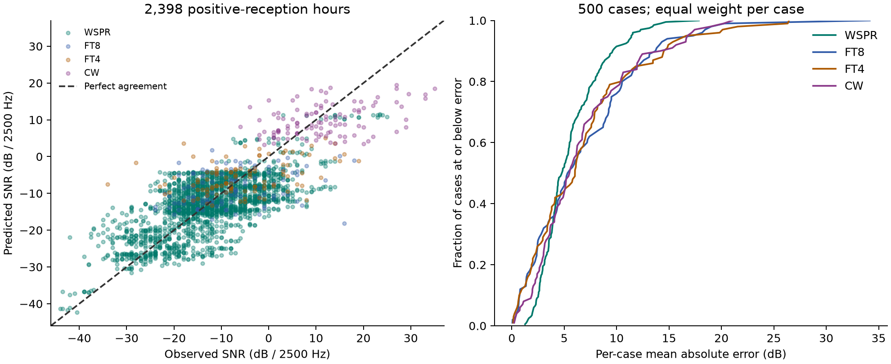

# 500 propagation comparisons — 40m

Completed **500 distinct path/day cases** covering **2,398 observed hours** on **36 UTC dates in 2025**. Each mode has unique directed four-character square pairs. The suite reruns the exported model against recorded positive receptions. These are outcome-blind subsets of the previously published test dates, not fresh independent validation.

Each case receives equal weight: overall MAE is **6.29 dB** (boosted baseline: **6.26 dB**). The adjusted model does not improve overall SNR accuracy on this suite. This deliberately balanced mode mix is not a population-wide accuracy estimate.

| Mode | Cases | Observed hours | Dates | Case-balanced MAE | Baseline MAE | Within 6 dB (hours) | 80% interval coverage (hours) |
|---|---:|---:|---:|---:|---:|---:|---:|
| WSPR | 200 | 2,085 | 36 | 5.56 dB | 5.45 dB | 59.1% | 86.3% |
| FT8 | 100 | 102 | 3 | 6.83 dB | 6.83 dB | 53.9% | 81.4% |
| FT4 | 100 | 104 | 3 | 6.79 dB | 7.17 dB | 49.0% | 81.7% |
| CW | 100 | 107 | 2 | 6.72 dB | 6.41 dB | 55.1% | 82.2% |

WSPR hourly ranking across 200 eligible cases has median Spearman correlation **0.383**, versus **0.315** for the baseline. The model-selected hour is on average **4.30 dB** below the strongest observed hour. Only reported hours compete; nothing is inferred about missing hours.

## Definitions and limits

- One case is a fixed transmitting/receiving station pair, in fixed squares, on one UTC day. The 500 cases do not represent 500 independent days or controlled experiments.
- Selection cycles through available date/distance strata with a seeded identifier hash; it never uses SNR or prediction error. WSPR requires six observed hours; other modes require one. This favors active observed paths, and is conditional on reception.
- Actual SNR is the source hourly aggregate in dB relative to 2500 Hz noise bandwidth. WSPR actuals and predictions are both shifted using reported power to a common **1 W reference** for hourly comparisons. This does not remove unknown antennas or noise. Multiple power records within an hour are collapsed by median. Other modes retain their unknown power.
- MAE averages absolute errors within each case, then averages cases. Hour-weighted MAE, RMSE, bias and the 90th-percentile absolute error are in summary.json. Interval coverage counts observed hours; intervals describe reported receptions.
- Primary predictions use actual historical preceding Kp/ap/Ap/SFI features. A separate portable-scenario test uses hourly Kp held steady for the preceding day, plus the recorded preceding-day SFI and Ap. These scenario assumptions can change predictions.
- The FT8/FT4 panel covers three dates and CW covers two. Their sparse observations do not support the same hourly-ranking claims as WSPR. No measured PHONE observations are available; PHONE margins remain theoretical.
- A good fit to received signals does not establish a calibrated 100 W/dipole reference, the unseen weak-signal distribution, or a probability of communication.

## Portable scenario-input check

| Mode | Full historical inputs MAE | Steady-Kp scenario MAE |
|---|---:|---:|
| WSPR | 5.56 dB | 5.58 dB |
| FT8 | 6.83 dB | 6.89 dB |
| FT4 | 6.79 dB | 6.76 dB |
| CW | 6.72 dB | 6.73 dB |

## Reproduce and inspect

Run `.venv/bin/python -m ml40.test500`. Membership, source checksums and model checksum are frozen before prediction. The script fails if the frozen membership or artifact changes; it does not retrain.

- [All 500 cases and per-case results](results/ml40/test500/cases.csv)
- [Every observed hour and prediction](results/ml40/test500/hourly_comparisons.csv)
- [Source aggregates, power and solar inputs](results/ml40/test500/observations.csv)
- [Exact model input snapshot](results/ml40/test500/inputs.parquet)
- [Summary metrics](results/ml40/test500/summary.json)
- [Frozen selection and source checksums](results/ml40/test500/plan.json)
- [Independent arithmetic and prediction verification](results/ml40/test500/verification.json)
- [Larger experiment and archive provenance](ML40_RESULTS.md)
