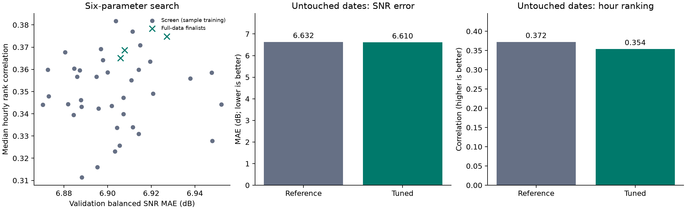

# Six-parameter tuning — 40m

Tuned model does not pass every fresh WSPR promotion gate; retain the reference.

The bounded search screened **36 randomized configurations plus the current configuration** on **112,871 training rows**, then retrained three finalists on **1,129,333 rows**. All six parameters varied. Selection used the existing 2024 validation dates; calibration remained separate. The final WSPR test uses twelve previously unused dates, one in each month of 2025. No absent reports become negative examples.

## Validation results

| Configuration | Median hourly ranking correlation | Balanced SNR MAE | Meets validation guards |
|---|---:|---:|---|
| Current exported model | 0.368 | 6.90 dB | Reference |
| Trial 29 | 0.365 | 6.91 dB | True |
| Trial 27 | 0.369 | 6.91 dB | True |
| Trial 3 | 0.375 | 6.93 dB | True |

## Selected parameters

| Parameter | Previous | Tuned |
|---|---:|---:|
| `max_iter` | 180 | 360 |
| `learning_rate` | 0.07 | 0.07 |
| `max_leaf_nodes` | 23 | 63 |
| `min_samples_leaf` | 60 | 100 |
| `l2_regularization` | 10 | 1 |
| `station_penalty` | 50 | 200 |

## Untouched WSPR final comparison

| Model | Reception aggregates | Dates | SNR MAE | Median hourly correlation | Loss from best observed hour | 80% interval coverage |
|---|---:|---:|---:|---:|---:|---:|
| reference | 150,844 | 12 | 6.63 dB | 0.372 | 5.12 dB | 80.8% |
| tuned | 150,844 | 12 | 6.61 dB | 0.354 | 4.93 dB | 80.9% |

The paired ranking comparison has **899 fixed-path/day cases**. The median-correlation difference is **-0.018**, with a 95% paired date-bootstrap interval of **[-0.051, +0.008]**, resampling all cases within each of twelve dates together (5,000 replicates). Twelve dates still limit confidence; this is not a guarantee for other dates, solar conditions or modes.

There are 900 eligible observed-hour curves. One challenger prediction curve is constant, so its rank correlation is undefined; the paired bootstrap uses the remaining 899 curves. The best-hour loss metric retains all 900 curves and selects the earliest observed hour when predictions tie.



## Published 500-case regression comparison

These previously examined cases are regression evidence, not new final validation. Each case has equal weight within its mode.

| Mode | Cases | Previous MAE | Tuned MAE |
|---|---:|---:|---:|
| CW | 100 | 6.72 dB | 6.70 dB |
| FT4 | 100 | 6.79 dB | 6.64 dB |
| FT8 | 100 | 6.83 dB | 6.82 dB |
| WSPR | 200 | 5.56 dB | 5.55 dB |

## Strict validation stress checks

For each check, both models are refitted after excluding the designated callsigns or geographic fields from training. Scores are on validation rows containing excluded endpoints. All station-offset residuals and preprocessing are derived from the retained training rows.

| Exclusion | Ranking cases | Previous-parameter MAE | Tuned MAE | Previous ranking | Tuned ranking |
|---|---:|---:|---:|---:|---:|
| station_holdout | 324 | 7.01 dB | 7.02 dB | 0.368 | 0.375 |
| geographic_holdout | 19 | 6.58 dB | 6.64 dB | 0.433 | 0.217 |

The geographic ranking check also regressed, but has only 19 cases. It is a warning about transfer to excluded fields rather than a precise estimate of worldwide geographic performance.


## Use the challenger

The tuned artifact is separate so that the original 500-case suite remains reproducible. Check the recommendation in its metadata before choosing it as the application default.

```sh
.venv/bin/python -m ml40.inference artifacts/gocap-40m-tuned.joblib JN76 FN31 2026-11-17T18:00Z --sfi 150 --kp 3 --ap 10
```


## Evidence and reproduction

```sh
.venv/bin/python -m ml40.tune_collect
.venv/bin/python -m ml40.tune fit
.venv/bin/python -m ml40.tune evaluate
```

- [Frozen search, parameter ranges and acceptance criteria](results/ml40/tuning/plan.json)
- [Every screen trial](results/ml40/tuning/screen_results.json)
- [Full run, validation and final results](results/ml40/tuning/run.json)
- [Independent output verification](results/ml40/tuning/verification.json)
- [Paired fresh path/day ranking results](results/ml40/tuning/fresh_ranking_pairs.csv)
- [All 500 regression-case comparisons](results/ml40/tuning/regression500_cases.csv)
- [Original experiment](ML40_RESULTS.md)

Paths above are under `results/ml40/tuning/` in this repository. Model predictions remain conditional on reported receptions, with unknown antennas and noise. Absolute 100 W/dipole and contact-probability calibration remain unproven.
