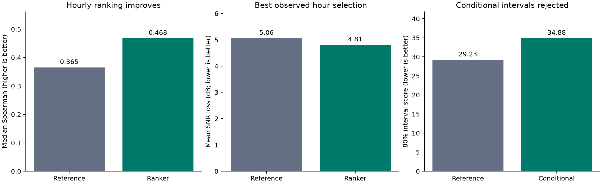

# Five 40m model improvements — experiment 3

**The direct hourly ranker improves the reserved-date comparison:** median Spearman correlation rises from **0.365 to 0.468**. The paired difference is **+0.103**, with a 95% date-bootstrap interval **[+0.057, +0.143]**. Mean loss from the strongest observed hour falls from **5.06 to 4.81 dB**.

The recommended package combines this new ranker with the established SNR model and intervals. The WSPR SNR challengers and conditional intervals were tested and were not promoted. The user confirmed archive-only operation; physical 100 W/dipole calibration remains unverified.

| Requested improvement | Implemented experiment | Outcome |
|---|---|---|
| Direct hourly learning | Pairwise XGBoost ranker; only positive observed hours compete | Promoted for WSPR hourly ranking |
| Coherent training sequences | Outcome-blind station-pair/day sampling across 96 planned historical dates | 203,931 hourly aggregates on 93 positive dates; 18,207 eligible rank-training groups |
| WSPR-focused versus pooled learning | WSPR-only, pooled, and shared model with cross-fitted source residual heads | Existing WSPR SNR model won validation; source heads remain experimental |
| Richer geometry and solar history | Nine-point path illumination; bearing; sunrise/sunset timing; IGRF degree-one magnetic latitude; completed 6/24/72h ap and previous 27-day SFI | Included in selected ranker; matched feature ablation below |
| Better uncertainty and reference calibration | 10th/90th conditional quantiles plus per-source/mode split calibration; documented measurement intake | Conditional intervals rejected on final interval score; no documented physical observations supplied |

## Data, fitting and final boundary

The coherent training dataset covers 93 positive-reception dates from 2010, 2013, 2016, 2019, 2022 and 2024. The 96-date plan was fixed before queries. Empty responses remain unknown. The matched-calendar scattered control has 564,335 hourly rows on 94 positive dates, so it is a comparison of sampling strategies on the same planned calendar, not perfectly matched actual day support or row counts. Pooled challengers add 117,714 historical FT8/FT4/CW training rows.

Ranking training uses **172,129 observed hours** in **18,207 fixed-station-pair/day groups**, with at least four reported hours. Reported WSPR power is normalized to a common 1 W reference before forming strength-order labels. Features contain neither station identifiers, report counts, measured SNR nor ranking labels. Pairwise loss compares received strengths; absent hours never receive labels.

Model and checkpoint decisions use the original 2024 validation dates. Interval calibration uses separate dates. The final dates are the third day of each month in 2025, disjoint from every original split and the previously used tuning dates. All component choices and strict exclusion fits were frozen before these final scores.

The new final SNR sample contains **151,396 positive hourly aggregates** on twelve dates. The denser independent pair/day cohort yields **3,564 eligible fixed-path/day curves** with at least six observed hours and three distinct strengths. The paired correlation comparison uses 3,563 curves; the reference has one constant prediction curve whose correlation is undefined. Best-hour loss retains all eligible curves, breaking ties in favor of the earliest observed hour.

## Reserved-date outcomes

| Metric | Established reference | Selected v3 component |
|---|---:|---:|
| WSPR SNR MAE | 6.68 dB | 6.68 dB (reference retained) |
| Median observed-hour rank correlation | 0.365 | 0.468 |
| Mean loss from best observed hour | 5.06 dB | 4.81 dB |

Bootstrap uncertainty resamples all cases from each UTC date together, using twelve date clusters and 5,000 replicates. This supports the observed ranking gain within this sampled reception population. Twelve dates in one year do not establish universal performance, open-path probabilities, or accuracy for unseen solar combinations.



## Model and feature comparisons

| WSPR SNR challenger | Validation balanced MAE | New-date MAE | New-date median rank correlation |
|---|---:|---:|---:|
| scattered_wspr_base | 6.98 dB | 7.16 dB | 0.351 |
| coherent_wspr_base | 7.74 dB | 7.86 dB | 0.324 |
| coherent_wspr_rich | 7.72 dB | 7.91 dB | 0.339 |
| pooled_rich | 7.90 dB | 8.07 dB | 0.332 |
| pooled_source_heads | 7.86 dB | 8.05 dB | 0.330 |

These normalized SNR challengers did not beat the established WSPR point model. Coherent sequences help provide relative-hour comparisons, but did not improve absolute SNR in these regressors. Unknown antenna/noise effects, sampling differences and station populations remain possible explanations rather than established causes.

The geometry/history ablation below holds the ranker architecture at 240 trees and depth 3 and changes only the feature set. These are diagnostics; the separately selected final ranker uses 120 trees and depth 5.

| Matched ranker | Validation correlation | New-date correlation | New-date best-hour loss |
|---|---:|---:|---:|
| ranker_base_240_3 | 0.462 | 0.430 | 5.13 dB |
| ranker_rich_240_3 | 0.466 | 0.434 | 4.76 dB |

## Strict excluded-station and geographic tests

Designated callsigns or two-character Maidenhead fields are excluded in both endpoint roles before fitting the stress models. The comparison uses the previously verified reference exclusion model and a refitted v3 ranker; their training samples differ, so this tests the complete model procedures rather than isolating a single feature.

| Exclusion | Fresh ranking cases | Reference correlation | V3 correlation |
|---|---:|---:|---:|
| station_holdout | 1,341 | 0.321 | 0.441 |
| geographic_holdout | 108 | 0.167 | 0.321 |

The geographic result has fewer cases and should be treated cautiously. These stress checks support further use of the ranker; they do not identify physical antenna gains.

## Conditional uncertainty experiment

The challenger predicts condition-dependent 10th and 90th SNR quantiles, sorts crossed bounds, includes the selected point estimate within the bounds, then applies a nonnegative per-source/mode conformal expansion determined from separate calibration dates.

| Interval measure | Existing bands | Conditional challenger |
|---|---:|---:|
| Observed coverage (nominal 80%) | 80.5% | 80.8% |
| Mean total width | 21.48 dB | 25.30 dB |
| Mean 80% interval score, lower is better | 29.23 | 34.88 |

The interval score penalizes width and observations outside the bounds. Similar coverage with wider, worse-scoring intervals does not justify replacing the existing bands. [Coverage by distance, illumination and geomagnetic activity](results/ml40/v3/interval_segments.csv) is retained for diagnosis. These intervals describe detected receptions, not unseen sub-threshold signals.

## Other modes and physical calibration

The FT8/FT4/CW comparisons below reuse previously published test data and are regression checks, not independent new-mode validation. The CW source-head choice was selected on validation, but is not included in the recommended package without stronger independent evidence.

| Mode | Test dates | Reference MAE | Experimental profile MAE |
|---|---:|---:|---:|
| CW | 2 | 6.84 dB | 6.76 dB |
| FT4 | 3 | 6.99 dB | 6.99 dB |
| FT8 | 3 | 6.81 dB | 6.81 dB |

A [documented-reference intake schema](results/ml40/v3/reference_measurement_schema.json) and validator are implemented. Actual positive measurements must include calibrated received signal power, 2500 Hz noise power, feedpoint transmit power, documented antennas and measurement provenance. The user chose archive-only work, so [the physical calibration audit](results/ml40/v3/physical_calibration_audit.json) records zero reference measurements and makes no physical calibration claim.

## Query the recommended package

The [recommended artifact](artifacts/gocap-40m-recommended.joblib) is **0.82 MiB** and loads without reception archives. It retains established SNR/interval outputs and adds the verified WSPR ranker.

```sh
.venv/bin/python -m ml40.v3_inference \
  artifacts/gocap-40m-recommended.joblib \
  JN76 FN31 2026-11-17T00:00Z \
  --sfi 150 --kp 3 --ap 10 --power-watts 100 --hours 24
```

Higher `relative_hour_rank_score` means a preferred hour within the same path/day. It is not a dB value or contact probability and is not comparable between different paths. The ranker was evaluated only among reported hours; a 24-hour scenario query is not proof that every unreported hour would support reception. FT8/FT4/CW queries return no dedicated rank score.

With no history file, the scenario assumes steady Kp over the completed preceding 72 hours and steady SFI over the preceding 27 completed days. `--ap` is independent previous-day Ap. A one-hour query can instead accept `--history-file` containing `kp_3h` (24 oldest-first values), `ending_boundary_utc` (the last completed three-hour boundary) and optional `sfi_previous27_days` (27 oldest-first values). Last values must match `--kp` and `--sfi`. Future or misaligned history is rejected.

Magnetic coordinates use degree-one IGRF-14 centered-dipole coefficients, not a full field-line/auroral coordinate calculation. Epochs outside 1900–2030, antipodal shortest-path ambiguity and marginal training-range violations are surfaced. Arbitrary date/solar queries remain conditional scenarios, not solar forecasts.

## Reproduce and inspect

```sh
.venv/bin/pip install -r requirements-v3-lock.txt
.venv/bin/python -m ml40.v3_collect
.venv/bin/python -m ml40.v3_train
.venv/bin/python -m ml40.v3_stress
.venv/bin/python -m ml40.v3_calibration
.venv/bin/python -m ml40.v3_evaluate
.venv/bin/python -m ml40.v3_verify
.venv/bin/python -m ml40.v3_deploy
.venv/bin/python -m ml40.v3_scenario_check
.venv/bin/python -m ml40.v3_report
```

- [Frozen experiment plan](results/ml40/v3/plan.json)
- [Validation, feature comparisons and final metrics](results/ml40/v3/run.json)
- [Paired actual-path ranking results](results/ml40/v3/paired_hour_rankings.csv)
- [Independent verification](results/ml40/v3/verification.json)
- [Recommended-package verification](results/ml40/v3/deployment_verification.json)
- [Recommended model metadata](artifacts/gocap-40m-recommended.json)
- [Experimental model metadata](artifacts/gocap-40m-v3.json)

Reception archives and solar-index provenance remain as documented in [README.md](README.md). Methods: [XGBoost pairwise ranking](https://xgboost.readthedocs.io/en/stable/tutorials/learning_to_rank.html), [scikit-learn quantile regression](https://scikit-learn.org/stable/auto_examples/ensemble/plot_gradient_boosting_quantile.html), [NOAA/IAGA IGRF-14](https://www.ncei.noaa.gov/products/international-geomagnetic-reference-field).

## Steady-history query diagnostic

With each hour's historical Kp/SFI/Ap retained but the preceding history assumed steady, the new ranker has median correlation **0.454**, versus **0.359** for the reference under the same assumption. Its mean best-observed-hour loss is **4.89 dB**. This post-freeze diagnostic does not select a model; it illustrates the cost of replacing actual history with scenario assumptions. It still supplies the actual current-hour indices, so it does not measure solar-forecast accuracy. [Inspect the diagnostic](results/ml40/v3/scenario_history_diagnostic.json).
