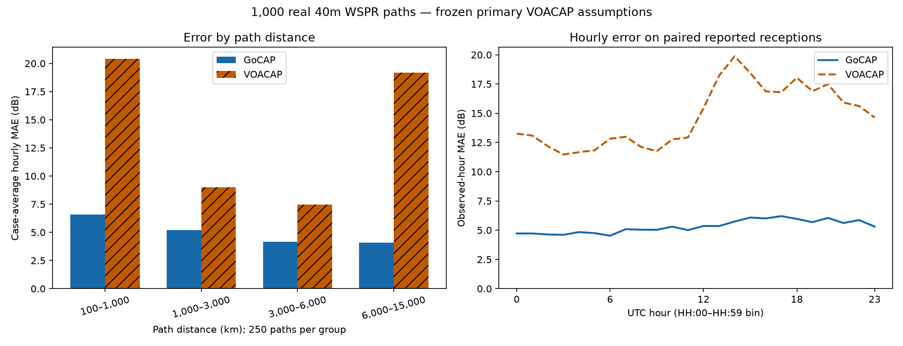
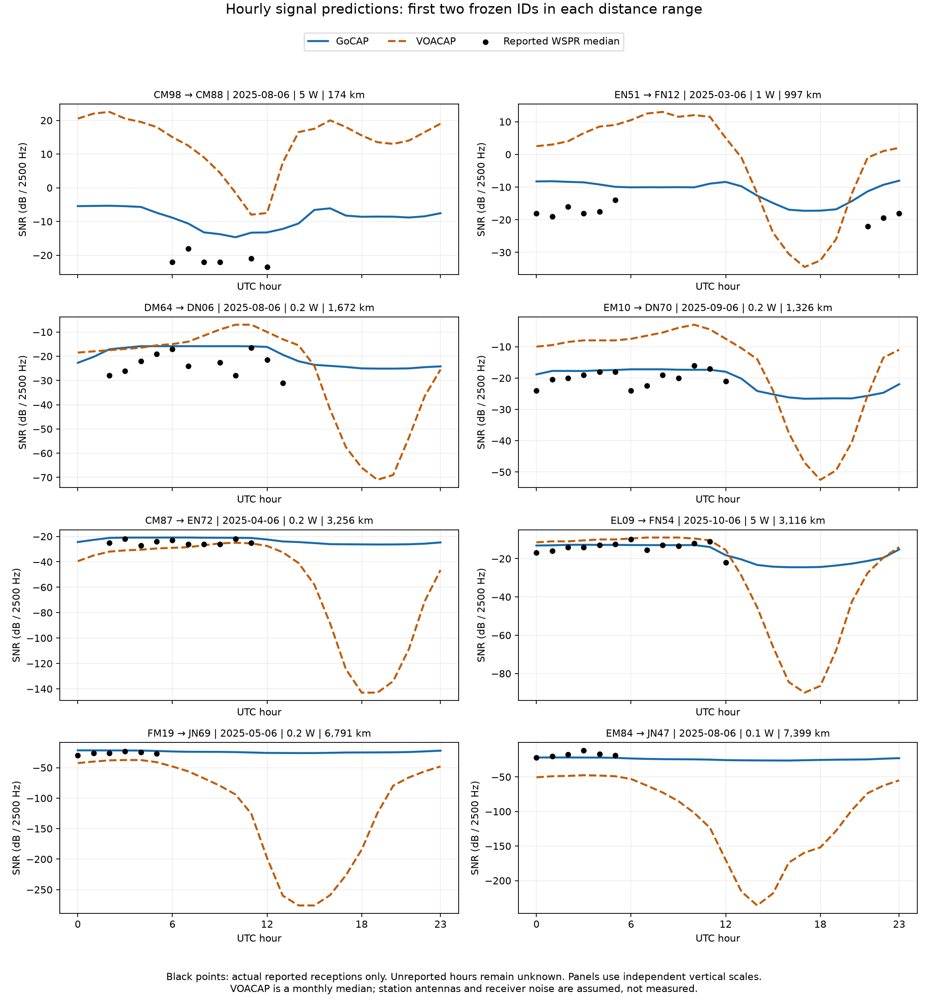

# GoCAP versus VOACAP: 1,000 real 40m paths

**GoCAP case-average hourly SNR error is 5.01 dB versus 14.00 dB for VOACAP** under the frozen primary assumptions. GoCAP has lower error on **855/1,000 paths**; VOACAP on **145**; exact ties: **0**. Truth consists of **9,967 observed hourly signal medians**, reconstructed from **31,840 positive WSPR reports**, on twelve 2025 dates.

The 1,000 distinct directed four-character square pairs exclude all paths in the earlier 100-case suite. Actual station antennas and noise are unknown. This is a received-signal hindcast comparison with explicit VOACAP assumptions, not a controlled physical calibration or a worldwide accuracy guarantee.

| Same paired observed hours | GoCAP | VOACAP |
|---|---:|---:|
| Case-average hourly MAE (primary) | 5.01 dB | 14.00 dB |
| Pooled hourly MAE | 5.15 dB | 13.93 dB |
| Pooled hourly RMSE | 6.57 dB | 19.24 dB |
| Signed bias: prediction − observation | 0.08 dB | 2.42 dB |

The paired case-average difference (GoCAP − VOACAP) is **-9.00 dB**, with a **95% date-cluster bootstrap interval [-9.95, -8.10] dB**. It uses 10,000 resamples of the twelve dates. More paths improve path coverage, but do not increase the number of independent dates. Station populations recur across paths. All results are for the same frozen model, with no fitting, offset correction or scenario selection using test outcomes.

## Hourly results

Both models produce curves for all **24,000 case-hours**. Error is measured only where reception was reported: **9,967 hours**; **14,033 hours remain unknown**, never zero or closed-path labels. Each path contributes its mean absolute error over its reported hours, then paths are weighted equally. Pooled hourly scores are secondary. Primary numeric coverage on paired truth is GoCAP **9,967** and VOACAP **9,967** hours; [all-observation coverage and metrics](results/ml40/voacap1000/summary.json) are retained separately.



| Path distance, km | Paths | GoCAP MAE | VOACAP MAE | GoCAP wins |
|---|---:|---:|---:|---:|
| 100–1,000 | 250 | 6.59 dB | 20.41 dB | 234 |
| 1,000–3,000 | 250 | 5.20 dB | 8.99 dB | 192 |
| 3,000–6,000 | 250 | 4.17 dB | 7.45 dB | 191 |
| 6,000–15,000 | 250 | 4.08 dB | 19.16 dB | 238 |

The UTC-hour figure pools the actual paired receptions in each hour; its path population changes with reporting. It is not an accuracy claim for hours with no measurements. [Exact UTC-hour results](results/ml40/voacap1000/utc_hour_results.csv) and [per-date results](results/ml40/voacap1000/date_results.csv) accompany the figure.



Examples are the first two hash-sorted frozen IDs in each distance range. Blue/orange curves cover all hours; black points are hourly median real receptions. They were not chosen by model performance. Panels have independent vertical scales to retain detail while showing the full native prediction range, including very weak unverified daytime predictions on long paths. [All 24,000 hourly rows](results/ml40/voacap1000/hourly_comparison.csv) include actual values where available and both predictions.

## VOACAP sensitivity

The primary setting remains `dipole10m_n150_s1.0`: native Method 30, CCIR coefficients, shortest great-circle path, 7.04 MHz, square-centre coordinates, reported transmit power, ideal half-wave horizontal dipoles 10 m high and broadside to the path at both ends, ground dielectric 4/conductivity 0.001 S/m, noise parameter 150, minimum takeoff 3°, final WDC-SILSO 13-month smoothed Version 2 SSN. Required reliability is 50%, WSPR nominal required SNR is −31 dB/2500 Hz; sporadic-E factor is zero.

VOACAP SNR50 in dB-Hz is converted to 2500 Hz by subtracting **33.9794 dB**. The requested-frequency output column is used, not MUF, REL or SNR90. Average the native H and H+1 SNR values in dB to approximate each [H,H+1) reception bin. Using the left or right native hour instead gives **14.05/14.15 dB** case-average MAE. Printed native SNR is rounded to integer dB. The engine pilot matched the documented dxtron API at all 24 hours.

All twelve settings were declared before prediction. SSN scale 0.6 explores a legacy convention; it is not an exact historical-scale reconstruction. No favorable setting replaces the primary after scoring.

| Antenna / noise / SSN scale | VOACAP case-average MAE | Numeric observed hours |
|---|---:|---:|
| dipole10m_n145_s0.6 | 14.48 dB | 9,967 |
| dipole10m_n145_s1.0 | 13.88 dB | 9,967 |
| dipole10m_n150_s0.6 | 14.58 dB | 9,967 |
| dipole10m_n150_s1.0 | 14.00 dB | 9,967 |
| dipole10m_n155_s0.6 | 14.98 dB | 9,967 |
| dipole10m_n155_s1.0 | 14.41 dB | 9,967 |
| isotropic_n145_s0.6 | 10.86 dB | 9,967 |
| isotropic_n145_s1.0 | 10.69 dB | 9,967 |
| isotropic_n150_s0.6 | 10.94 dB | 9,967 |
| isotropic_n150_s1.0 | 10.66 dB | 9,967 |
| isotropic_n155_s0.6 | 11.38 dB | 9,967 |
| isotropic_n155_s1.0 | 10.99 dB | 9,967 |

GoCAP with steady preceding solar history, corresponding to scalar-query assumptions, gives **5.01 dB** case-average MAE. Primary GoCAP scoring uses actual completed historical solar context.

## What this means

This experiment measures hour-by-hour received WSPR SNR accuracy on frequently detected paths, under reported power and unknown hardware. Requiring at least six observed hours selects active, repeatedly detectable paths. Selection does not use SNR values or model errors, but observation availability is itself detection-selected. The balanced distance design is not traffic-weighted global performance.

VOACAP's target is the monthly hourly median across days; our observations are detected signals on a particular day. GoCAP was trained on a received-signal population and additionally sees completed daily solar history including Kp/Ap. VOACAP uses smoothed monthly SSN. Final solar data, including a centred 13-month SSN series that would not yet have been known on the query date, make this a retrospective hindcast. The result cannot establish band-open probabilities, undetected signal strength, calibrated 100 W/dipole performance, other-mode accuracy or forecast-vintage skill.

The earlier 100-case benchmark remains unchanged. This suite expands path coverage while using the same dates, source family and modeling assumptions; it is not an independent new-year validation, and its different path mix means changes in aggregate error are not model improvements.

## Reproduce and inspect

- [All 1,000 path results](results/ml40/voacap1000/case_results.csv)
- [Hourly predictions and real signals](results/ml40/voacap1000/hourly_comparison.csv)
- Full 12-scenario hourly output: `results/ml40/voacap1000/voacap_all_scenarios.csv` (generated locally; excluded from Git)
- [Frozen protocol](results/ml40/voacap1000/protocol.json) and [case freeze](results/ml40/voacap1000/case_freeze.json)
- [Summary](results/ml40/voacap1000/summary.json), [independent verification](results/ml40/voacap1000/verification.json), [run checksums](results/ml40/voacap1000/run_manifest.csv)
- [Original 100-case report](VOACAP_COMPARISON.md)

Raw reports and exact source queries: `data/ml40/voacap1000/raw/`. Input/output decks: `data/ml40/voacap1000/runs/<case_id>/<scenario>/`. All endpoints are four-character Maidenhead square centres. Eligibility and quotas match the earlier suite: fixed station pair/day/reported power, at least six reported hours, power 20–50 dBm, 100–15,000 km, 250 unique directed paths per distance stratum. Identifier-hash/date round-robin selection uses seed `gocap-voacap1000-2026-v1`.

The original hash128 source sample has too few long paths for 250 per stratum. Source collection therefore retains hash128 at shorter distances and adds hash16 for source distances ≥2,700 km (a conservative buffer around the 3,000 km square-centre split). This rule was frozen before scoring. No date hit the 250,001-row cap. Original 100-suite directed paths are excluded before selection. Dates are the sixth day of each 2025 month. Model-fitting feature data ends in 2024; the model file is unchanged and checksummed.

```sh
export GOCAP_VOACAP_CASES=1000
.venv/bin/python -m ml40.voacap_collect
.venv/bin/python -m ml40.voacap_prepare
.venv/bin/python -m ml40.voacap_run
.venv/bin/python -m ml40.voacap_verify
.venv/bin/python -m ml40.voacap_verify_extra
.venv/bin/python -m ml40.voacap1000_report
.venv/bin/python -m unittest discover -v
```

Unsetting the environment variable selects the original 100-case suite. Cached source files and native binary must match frozen hashes; do not overwrite them with refreshed data. Native build instructions remain in [the original report](VOACAP_COMPARISON.md). A changed binary or source requires a separately versioned protocol.

**Validation: share with caveats.** All 12,000 native outputs and their power/solar/noise/antenna/coordinate input cards are independently checked; all real hourly medians are independently rebuilt from raw reports; hashes, path exclusions, distance quotas, direct model predictions and primary calculations are verified. All 38 tests pass. Physical hardware calibration, unknown-hour accuracy and operational forecast performance remain unverified.

Sources: [VOACAP SNR distribution and units](https://www.voacap.com/2023/understanding/muf.html), [VOACAP smoothed SSN guidance](https://www.voacap.com/2023/understanding/choosingssn.html), [native engine source](https://github.com/jawatson/voacapl) at commit `c12a98b348c39f36f2659b8b3aa97b86284c8a1d`, [dxtron API documentation](https://voacap.dxtron.com/api/docs/), [official SILSO data](https://www.sidc.be/SILSO/DATA/SN_ms_tot_V2.0.txt). Sunspot data credit: WDC-SILSO, Royal Observatory of Belgium, Brussels, DOI 10.24414/qnza-ac80; CC BY-NC research use. Real reception source: [WSPR.live](https://wspr.live/) with exact archived query/response metadata.
