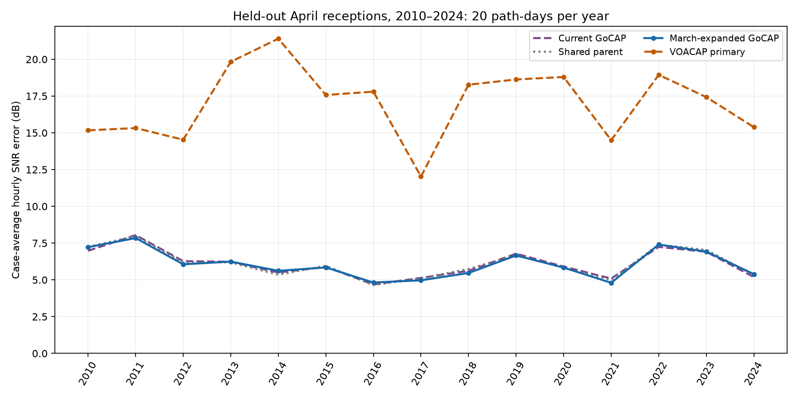
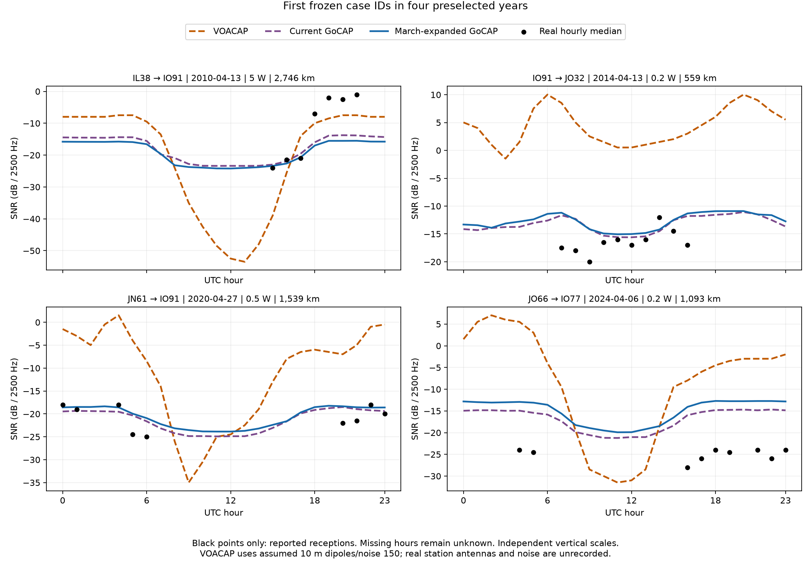

# GoCAP versus VOACAP across 2010–2024

**The March-expanded model has lower received-signal error than VOACAP in every sampled year.** Across **300 held-out path-days**, equally weighted by case and year, its hourly SNR MAE is **6.07 dB**, versus **17.04 dB** for the frozen primary VOACAP assumptions. GoCAP wins **262/300** cases. These are real reported receptions under unknown station hardware; this is not proof of universally better propagation physics.

Truth contains **3,081 hourly medians from 11,050 positive WSPR archive reports**, on **60 held-out April dates across 15 years**. All three GoCAP models and the native engine were frozen; no fitting or corrections were made using this benchmark.

| Same 3,081 observed hours | Case-average hourly MAE | Pooled hourly MAE | RMSE | Signed bias (prediction−observation) |
|---|---:|---:|---:|---:|
| March-expanded GoCAP | 6.074 dB | 6.103 dB | 7.643 dB | 0.167 dB |
| Shared parent | 6.113 dB | 6.152 dB | 7.669 dB | 0.017 dB |
| Current default GoCAP | 6.099 dB | 6.128 dB | 7.661 dB | -0.021 dB |
| VOACAP primary | 17.041 dB | 16.862 dB | 20.156 dB | 13.313 dB |

The March-model minus VOACAP difference is **-10.967 dB**, with 95% year-cluster bootstrap interval **[-12.180, -9.747] dB**. There are 15 year clusters and only 20 cases per year; resampling describes this design, not worldwide prediction confidence. All 300 cases and all **3,081** observed hours have numeric VOACAP predictions under every declared scenario.

**The larger March training set does not establish an improvement over existing GoCAP here.** March versus current default changes case MAE by **-0.025 dB**, interval **[-0.105, 0.058] dB**. Versus the shared parent the change is **-0.039 dB**, interval **[-0.106, 0.032] dB**. Both intervals include zero. The default stays unchanged and the March artifact remains experimental.



| Year | March GoCAP MAE | Current GoCAP MAE | VOACAP MAE | GoCAP wins | Median path km | Smoothed SSN v2 |
|---|---:|---:|---:|---:|---:|---:|
| 2010 | 7.23 | 6.98 | 15.17 | 15/20 | 1,487 | 20.8 |
| 2011 | 7.84 | 8.05 | 15.32 | 15/20 | 1,109 | 61.1 |
| 2012 | 6.06 | 6.28 | 14.53 | 17/20 | 1,046 | 95.1 |
| 2013 | 6.24 | 6.23 | 19.83 | 19/20 | 662 | 84.3 |
| 2014 | 5.62 | 5.50 | 21.40 | 18/20 | 814 | 116.4 |
| 2015 | 5.85 | 5.89 | 17.57 | 17/20 | 1,070 | 78.9 |
| 2016 | 4.82 | 4.69 | 17.80 | 18/20 | 960 | 47.8 |
| 2017 | 4.97 | 5.14 | 12.03 | 18/20 | 1,651 | 24.8 |
| 2018 | 5.47 | 5.62 | 18.27 | 20/20 | 1,169 | 7.8 |
| 2019 | 6.66 | 6.79 | 18.63 | 17/20 | 1,218 | 4.3 |
| 2020 | 5.84 | 5.91 | 18.80 | 19/20 | 1,256 | 3.6 |
| 2021 | 4.80 | 5.09 | 14.50 | 19/20 | 1,376 | 24.8 |
| 2022 | 7.40 | 7.24 | 18.94 | 15/20 | 1,116 | 73.0 |
| 2023 | 6.92 | 6.91 | 17.43 | 17/20 | 734 | 122.9 |
| 2024 | 5.39 | 5.19 | 15.39 | 18/20 | 1,102 | 144.4 |

Every year has 20 cases. Path/station populations, hardware, reporting and space weather differ, so these year differences must not be interpreted as a causal solar-cycle effect. No distance quota was imposed because the early network was sparse. Actual case distances span **111–14,972 km**; most median distances are around 1,000 km. This cohort is not directly comparable with the distance-balanced 2025 suites.

## Why these are genuine held-out dates

The March-expanded model learned from every available March day in 2010–2024. Scoring those same March observations would be a resubstitution test. Instead, source windows are **April 6, 13, 20 and 27 in every year**, all absent from the original and expanded point-fitting partitions. Before prediction, identifier hashes selected 20 eligible directed square-pair path-days per year, round-robin across the four dates.

The cases are fixed station pair/day/four-character endpoint squares/reported power/decoder context. Eligibility requires at least 6 observed hours, 20–50dBm reported power and 100–15,000km distance. Square pairs are unique within a year; repeats across years are permitted. There are **291 distinct directed square pairs** overall. SNR values, model predictions and errors do not choose cases.

This is a **retrospective within-period held-out-day test**, not forward-year or operational forecasting. The models use training observations from later years when predicting an earlier held-out day, as well as final historical solar series. It tests April transfer across the expanded year span, not accuracy on March fitting records or every season.

## Hardware assumptions and the large VOACAP bias

Primary VOACAP remains `dipole10m_n150_s1.0`: Method 30, CCIR, shortest great-circle path at 7.04 MHz between square centres, actual reported power, half-wave horizontal dipoles 10 m high broadside to the path at both ends, ground dielectric 4/conductivity 0.001 S/m, noise parameter 150, minimum takeoff 3°, smoothed SILSO Version 2 SSN. Reported power is matched; actual antennas, losses and receiver noise are not measured.

Under those assumptions VOACAP's mean prediction is **13.31 dB higher** than the observed SNR, versus **0.17 dB** for GoCAP. This large bias materially contributes to the result. Unknown hardware/noise, climatological versus daily targets and reception selection are unresolved explanations, not measured causes. A controlled reference-station calibration would be needed to attribute the discrepancy.

All twelve predeclared antenna/noise/SSN settings were scored without selecting a new primary afterward. VOACAP case MAE spans **11.01–19.02 dB**. The range makes clear that the comparison depends on assumptions, even though GoCAP is lower across the declared settings.

| VOACAP setting | Case-average MAE |
|---|---:|
| dipole10m_n145_s0.6 | 15.425 dB |
| dipole10m_n145_s1.0 | 15.147 dB |
| dipole10m_n150_s0.6 | 17.336 dB |
| dipole10m_n150_s1.0 | 17.041 dB |
| dipole10m_n155_s0.6 | 19.019 dB |
| dipole10m_n155_s1.0 | 18.739 dB |
| isotropic_n145_s0.6 | 11.289 dB |
| isotropic_n145_s1.0 | 11.010 dB |
| isotropic_n150_s0.6 | 12.931 dB |
| isotropic_n150_s1.0 | 12.589 dB |
| isotropic_n155_s0.6 | 14.538 dB |
| isotropic_n155_s1.0 | 14.117 dB |

The 0.6 SSN factor is a legacy-convention sensitivity, not an asserted exact historic-scale reconstruction. The model's SNR50 is monthly climatology across days; truth is detected receptions on particular days. GoCAP was trained on reported receptions and uses completed daily Kp/Ap/F10.7 history, while VOACAP uses smoothed monthly SSN. No controlled hardware match, band-open probability or PHONE calibration is claimed.

Native SNR in dB-Hz is converted to 2500 Hz by subtracting 33.9794 dB. The requested 7.04 MHz column is parsed, not MUF or REL. Average native H/H+1 dB SNR to approximate the reported hourly-bin centre. Using native left/right hours instead gives **17.212/17.086 dB** case-average MAE. The engine and output parsing are unchanged from the API-validated earlier comparisons.

## Hourly examples and missing data



Examples are the first frozen hash IDs from preselected 2010/2014/2020/2024, never selected by performance. All **7,200 case-hours** have requested predictions. Only **3,081** have measured truth; **4,119** stay unknown. A missing report is never zero or a closed-path label. Panels use independent vertical scales and all SNRs use 2500 Hz noise reference.

## Historical context and source sampling

Code 0 legacy records account for **220 cases**, pre-2023 code 1 for **40**, and modern ordinary code 1 for **40**. Legacy decoder/mode metadata is uncertain; those populations do not imply one verified hard decoding threshold. Code 0 is retained only before 2020-05-01 in this April test. Code 1 before 2023-01-16 can mix WSPR/FST4W metadata as documented by the source. Known other codes are excluded.

Coherent station-pair/day hash sampling uses divisor 8 for 2010–2015 and 128 for 2016–2024 to give the sparse early network enough eligible paths. Each request is time/band bounded and sequential; a 50,001-row cap causes failure rather than truncation. Only identifier-based selection follows. The equal 20/year design is deliberate, not a traffic-weighted score over every report ever received.

## Evidence and reproduction

- [All 300 case results](results/ml40/years15/case_results.csv), [per-year results](results/ml40/years15/per_year.csv), [all 7,200 hourly comparisons](results/ml40/years15/hourly_comparison.csv).
- [Frozen plan](results/ml40/years15/plan.json), [case freeze](results/ml40/years15/case_freeze.json), [summary](results/ml40/years15/summary.json), [sensitivity](results/ml40/years15/sensitivity.csv).
- [Independent verification](results/ml40/years15/verification.json), [all 3,600 native run checksums](results/ml40/years15/run_manifest.csv).

Working inputs stay under ignored `data/ml40/years15/`: exact raw requests/responses and retrieval metadata, canonicalized source features, observed case features, full native scenario Parquet, and per-case native input/output decks. Parent/current/March model hashes and fitting data are unchanged.

```sh
.venv/bin/python -m ml40.years_collect
.venv/bin/python -m ml40.years_prepare
.venv/bin/python -m ml40.years_run
.venv/bin/python -m ml40.years_verify
.venv/bin/python -m ml40.years_report
.venv/bin/python -m unittest discover -v
```

Reproduction requires the cached fitting-date manifests, source inputs and native engine matching frozen hashes, as described in [README](README.md). This run does not train or promote a model. Data credits: WSPRNet volunteer contributors/WSPR Live; GFZ and DRAO/NRCan for solar/geomagnetic context; IAGA/NOAA for magnetic coefficients; WDC-SILSO, Royal Observatory of Belgium, DOI 10.24414/qnza-ac80, CC BY-NC for SSN. Sources: [WSPR Live code mapping/access](https://wspr.live/), [VOACAP SNR distribution](https://www.voacap.com/2023/understanding/muf.html), [VOACAP SSN guidance](https://www.voacap.com/2023/understanding/choosingssn.html).

**Share with caveats:** all 3,081 measured medians were independently rebuilt from 11,050 raw reports; all 3,600 native outputs/input power/solar/noise/antenna/coordinate cards were independently checked; source/model hashes, fitting-date exclusions, year/case/hour metrics and year-bootstrap intervals were verified. Actual hardware calibration, unknown-hour accuracy, every-season performance and forward forecasting remain unverified.
