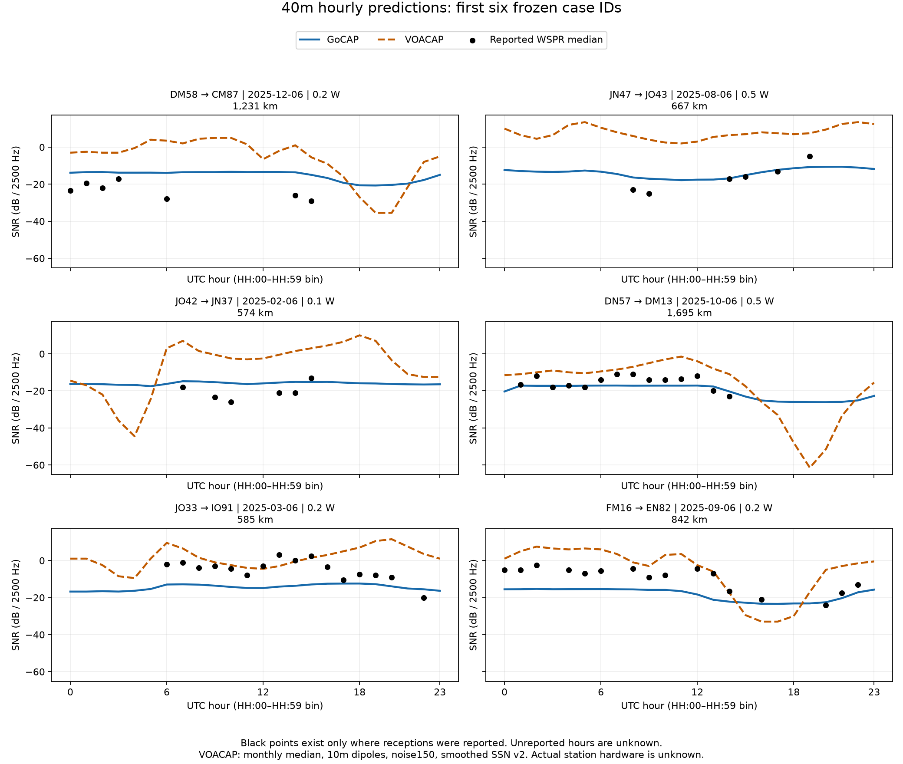
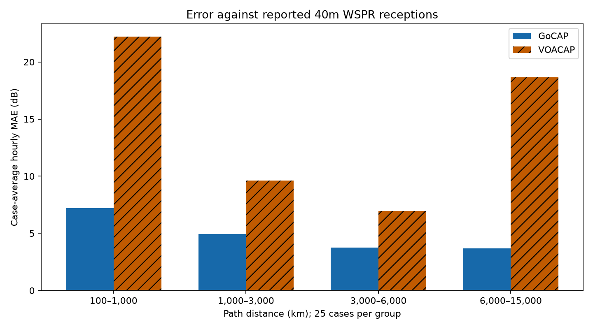

# GoCAP versus VOACAP: 100 real-data 40m cases

**GoCAP has lower hourly SNR error in 84/100 cases.** Equally weighted case mean absolute error is **4.90 dB for GoCAP** and **14.37 dB for VOACAP**, on **968 positive WSPR hourly aggregates**. This compares predictions against received signals with unknown real antennas and noise; it is not a controlled physical calibration or proof of universal superiority.

| Metric on the same 968 observed hours | GoCAP | VOACAP |
|---|---:|---:|
| Case-average hourly MAE (primary) | 4.90 dB | 14.37 dB |
| Pooled hourly MAE | 5.18 dB | 14.00 dB |
| Pooled hourly RMSE | 6.78 dB | 17.76 dB |
| Signed bias (prediction − observation) | 0.23 dB | 2.88 dB |

The paired case-average difference, GoCAP minus VOACAP, is **-9.47 dB**; the 95% date-cluster bootstrap interval is **[-10.70, -8.30] dB**. There are only 12 independent sampled dates; the interval describes this design, not global performance. VOACAP is better in 16 cases; no exact ties. Neither predictor was fitted or adjusted using these results.

## Hour-by-hour predictions

Every case has all 24 UTC-hour predictions from both models. Error is scored only where a real reception exists. The 1,432 unreported case-hours remain unknown, never zero or “closed”. Cases are one fixed transmitter/receiver/day/power, so 100 tests contain 968 separately observed hourly values.



Examples are the first six frozen hash-sorted IDs, not cases selected for favorable appearance. Black dots are hourly median reported SNR; continuous curves include unverified hours.



| Distance km | Cases | GoCAP MAE | VOACAP MAE |
|---|---:|---:|---:|
| 100to1000 | 25 | 7.20 dB | 22.22 dB |
| 1000to3000 | 25 | 4.93 dB | 9.63 dB |
| 3000to6000 | 25 | 3.77 dB | 6.97 dB |
| 6000to15000 | 25 | 3.70 dB | 18.66 dB |

## What the comparison establishes

On this fresh, observed-reception sample, GoCAP better estimates typical received WSPR strength. The result supports the hourly empirical model for this population. It does not validate band-open probabilities, undetected signals, calibrated antenna gain, other modes, or arbitrary solar-cycle extrapolation. Requiring six observed hours favors active, repeatedly detectable paths. The distance-balanced design is deliberately not a traffic-weighted worldwide score.

VOACAP predicts a monthly hourly median across days, while our truth is the median of detected signals on a specific day. This target difference and reception selection can favor GoCAP, trained on reported receptions. GoCAP additionally uses completed daily solar history including Kp/Ap; VOACAP uses a smoothed monthly SSN. Final solar observations and the centered 13-month SSN series make this a retrospective hindcast, not a forecast-vintage evaluation. [VOACAP explains its monthly SNR distribution](https://www.voacap.com/2023/understanding/muf.html) and [required smoothed SSN convention](https://www.voacap.com/2023/understanding/choosingssn.html).

## Predeclared VOACAP assumptions and sensitivity

Primary: native Method 30, CCIR coefficients, short great-circle path at 7.04 MHz between four-character square centres; reported WSPR transmit power; half-wave horizontal dipoles 10 m high at both ends, broadside toward the path; ground dielectric 4/conductivity 0.001 S/m; man-made noise parameter 150; minimum takeoff 3°; WDC-SILSO 13-month smoothed Version 2 SSN. The 100 case IDs and all 12 settings were frozen before scoring. Actual hardware and local noise are unavailable.

VOACAP native SNR50 is dB-Hz. Subtract 33.9794dB to compare against WSPR SNR in2500Hz. Use the requested 7.04 MHz column, not the separate MUF column or REL percentages. Native whole-hour H/H+1 predictions are averaged in dB to approximate the observed [H,H+1) bin centre. This is an approximation; left-edge/right-edge case MAEs are 14.50/14.38dB. Output SNR is rounded to integer dB before interpolation.

Sensitivity uses ideal 0 dBi isotropic antennas as well as dipoles; noise parameters 145/150/155; SSN scales 1.0/0.6. The 0.6 factor explores legacy SSN conventions and is not asserted to be an exact historical-scale reconstruction. No winning setting was chosen after seeing errors. All 12 settings give predictions for all 968 observed hours.

| Antenna / noise / SSN scale | Case-average MAE |
|---|---:|
| dipole10m_n145_s0.6 | 14.98 dB |
| dipole10m_n145_s1.0 | 14.20 dB |
| dipole10m_n150_s0.6 | 15.18 dB |
| dipole10m_n150_s1.0 | 14.37 dB |
| dipole10m_n155_s0.6 | 15.69 dB |
| dipole10m_n155_s1.0 | 14.84 dB |
| isotropic_n145_s0.6 | 11.45 dB |
| isotropic_n145_s1.0 | 11.16 dB |
| isotropic_n150_s0.6 | 11.60 dB |
| isotropic_n150_s1.0 | 11.12 dB |
| isotropic_n155_s0.6 | 12.13 dB |
| isotropic_n155_s1.0 | 11.48 dB |

GoCAP’s steady-history scalar-query diagnostic is 4.89dB case-average MAE; primary scoring uses actual completed history. Sensitivity results do not justify claiming known physical station calibration.

## Evidence and reproduction

The local [VOACAP port](https://github.com/jawatson/voacapl) was built from commit `c12a98b348c39f36f2659b8b3aa97b86284c8a1d`. A separate pilot exactly matched all 24 SNR outputs from the documented [dxtron public API](https://voacap.dxtron.com/api/docs/). Bulk tests ran locally. Engine inputs and outputs, source queries, retrieval times, model hashes and all 1200 run hashes are retained. WDC-SILSO series credit: WDC-SILSO, Royal Observatory of Belgium, Brussels, DOI 10.24414/qnza-ac80; [official monthly smoothed data](https://www.sidc.be/SILSO/DATA/SN_ms_tot_V2.0.txt), CC BY-NC research use.

- [All 100 case results](results/ml40/voacap100/case_results.csv)
- [All 2,400 hourly comparisons](results/ml40/voacap100/hourly_comparison.csv)
- Full 12-scenario hourly outputs: `results/ml40/voacap100/voacap_all_scenarios.csv` (generated locally; excluded from Git)
- [Frozen protocol](results/ml40/voacap100/protocol.json) and [case freeze](results/ml40/voacap100/case_freeze.json)
- [Independent verification](results/ml40/voacap100/verification.json) and [native/API pilot](results/ml40/voacap100/engine_validation.json)
- [Per-run checksums](results/ml40/voacap100/run_manifest.csv)

Raw archive data: `data/ml40/voacap100/raw/`; native input/output decks: `data/ml40/voacap100/runs/<case_id>/<scenario>/`. Dataset eligibility: WSPR code1, valid40m frequencies and locations; at least 6 reported hours; fixed reported power 20–50dBm;100–15,000km; unique directed square pair. Date 6 of each 2025 month is new WSPR test data, excluded from model fitting. Source-pair/day hash sampling precedes case hash selection. Exact source queries are in raw metadata.

```sh
bash scripts/build_voacap.sh   # only if native engine is absent
.venv/bin/python -m ml40.voacap_collect
.venv/bin/python -m ml40.voacap_prepare
.venv/bin/python -m ml40.voacap_run
.venv/bin/python -m ml40.voacap_verify
.venv/bin/python -m ml40.voacap_verify_extra
.venv/bin/python -m ml40.voacap_report
.venv/bin/python -m unittest discover -v
```

The SILSO source file is cached and checksummed; refreshes must create a new protocol rather than overwrite this frozen test. Installed native binary hashes may differ across compilers; a rebuilt engine requires a separately versioned protocol and the API pilot check before scoring. Existing run caches must match frozen input decks.

**Validation: share with caveats.** Independently reconstructed all 1200 native outputs and primary metrics, checked source/model hashes, preserved 968 observations and 1,432 unknowns, and confirmed that direct predictions on observed feature rows exactly match the generated 24-hour frames. All 35 unit tests pass. Hardware calibration, nondetection accuracy and real-time forecast skill remain unverified.
